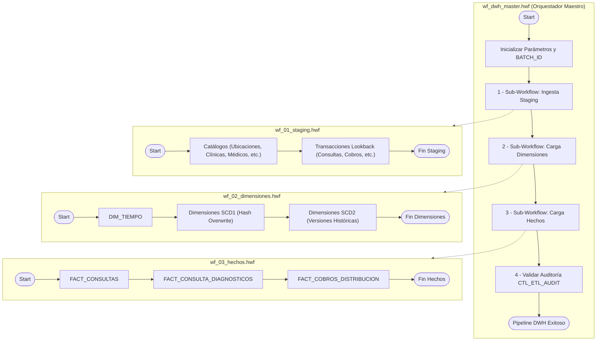
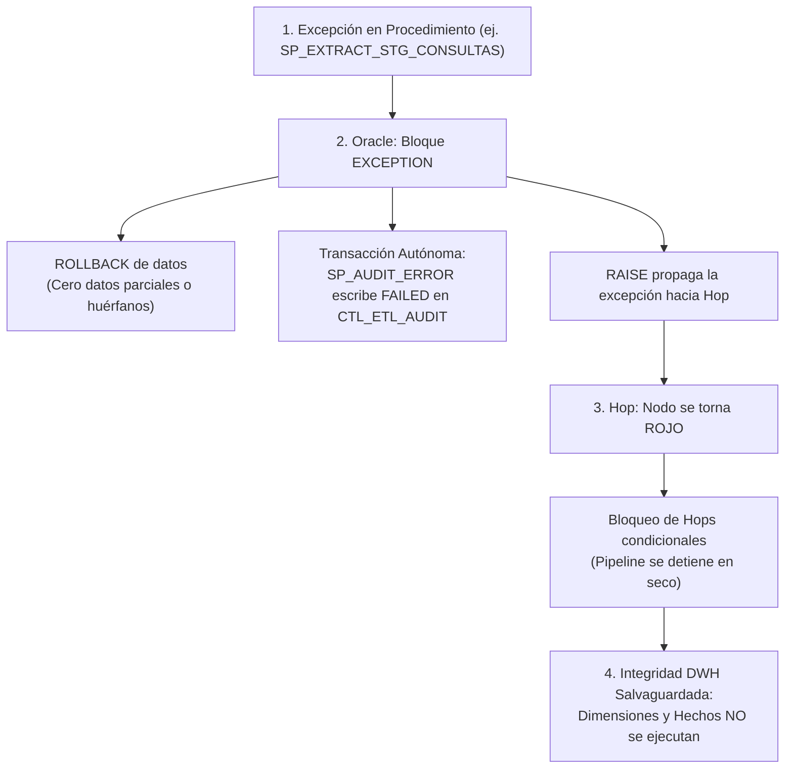

# Orquestación de Pipeline Analítico con Apache Hop

Este directorio contiene la solución completa de orquestación visual y automatizada para el **Data Warehouse de la Red Asistencial de Clínicas** utilizando **Apache Hop**.

## 1. Arquitectura de Orquestación

En este proyecto se implementa un patrón **ELT Empresarial (Extract-Load-Transform)**:

- **Motor de Datos (Heavy Lifting):** Oracle Database ejecuta los 34 stored procedures optimizados en memoria y disco (cálculo de hashes SHA-256 al vuelo, resolución de Surrogate Keys, historización SCD2 e inserciones direct-path `/*+ APPEND */`).
- **Plano de Control (Orquestador):** **Apache Hop** actúa como el director de orquesta mediante **Workflows (`.hwf`)**, coordinando la secuencia de ejecución, gestionando variables, controlando dependencias, detectando fallos y registrando la auditoría.



## 2. Estructura de Archivos

```plaintext
/HOP
├── metadata/
│   └── relational-database-connection/
│       └── Oracle_RedClinicas_DWH.json  <- Metadata de conexión JDBC nativa a Oracle
├── wf_dwh_master.hwf                    <- Workflow maestro (orquesta los 3 sub-workflows)
├── wf_01_staging.hwf                    <- Workflow de extracción Staging (18 tablas)
├── wf_02_dimensiones.hwf                <- Workflow de dimensiones (Tiempo + 6 SCD1 + 3 SCD2)
├── wf_03_hechos.hwf                     <- Workflow de hechos (3 tablas con SK lookups)
└── README.md                            <- Este manual de operación
```

## 3. Detalle de Cada Workflow

Cada workflow en Apache Hop contiene una secuencia estructurada de acciones. A continuación se desglosa el comportamiento técnico, parámetros, bloques PL/SQL ejecutados y tablas involucradas para cada uno de los 4 archivos `.hwf`.

### 3.1 `wf_dwh_master.hwf` — Orquestador Maestro End-to-End

- **Archivo físico:** [`HOP/wf_dwh_master.hwf`](file:///d:/Diego/Cursos/KODIGO%20SQL%20IA/ProyectoFinal/HOP/wf_dwh_master.hwf)
- **Propósito:** Actúa como el controlador general del pipeline corporativo. Coordina la ejecución ordenada de las tres capas (Staging $
  ightarrow$ Dimensiones $
  ightarrow$ Hechos), garantiza la propagación del `BATCH_ID` único y valida la ausencia de fallos en la tabla centralizada de auditoría `CTL_ETL_AUDIT`.
- **Parámetros configurables:**
  - `TIPO_CARGA`: `'INCREMENTAL'` o `'FULL'`.
  - `DIAS_LOOKBACK`: Días de retroceso para transacciones (default: `3`).
  - `FECHA_CORTE`: Fecha fija opcional (`YYYY-MM-DD`).
  - `BATCH_ID`: Clave alfanumérica de corrida (autogenerada si está vacía).

#### Matriz de Acciones (Nodos) del Orquestador Maestro


| # | Nombre de la Acción en Hop         | Tipo       | Objeto Invocado / Lógica        | Descripción Técnica                                                                                                                                                                    |
| - | ----------------------------------- | ---------- | -------------------------------- | ---------------------------------------------------------------------------------------------------------------------------------------------------------------------------------------- |
| 1 | **Start**                           | `SPECIAL`  | N/A                              | Punto de entrada del workflow.                                                                                                                                                           |
| 2 | **Registrar Inicio y Batch ID**     | `SQL`      | `SELECT SYSTIMESTAMP FROM DUAL;` | Verifica la conectividad con Oracle y asegura que la sesión esté lista para procesar el lote analítico.                                                                               |
| 3 | **Sub-Workflow: Ingesta Staging**   | `WORKFLOW` | `wf_01_staging.hwf`              | Invoca el workflow de Staging heredando todos los parámetros (`pass_all_parameters = Y`) en modo bloqueante sincrónico (`wait_until_finished = Y`).                                    |
| 4 | **Sub-Workflow: Carga Dimensiones** | `WORKFLOW` | `wf_02_dimensiones.hwf`          | Invoca el workflow de Dimensiones tras la culminación exitosa de Staging.                                                                                                               |
| 5 | **Sub-Workflow: Carga Hechos**      | `WORKFLOW` | `wf_03_hechos.hwf`               | Invoca el workflow de Tablas de Hechos tras la actualización de todas las dimensiones.                                                                                                  |
| 6 | **Verificar Control de Auditoria**  | `SQL`      | Bloque PL/SQL de Validación     | Valida en`CTL_ETL_AUDIT` si algún procedimiento individual del lote falló. Si detecta registros en `FAILED`, eleva un `RAISE_APPLICATION_ERROR(-20020)` forzando la detención de Hop. |
| 7 | **Pipeline DWH Exitoso**            | `SUCCESS`  | N/A                              | Señal de éxito integral que se notifica a Hop GUI / consola.                                                                                                                           |

#### Bloque PL/SQL del Nodo de Validación de Auditoría:

```sql
DECLARE
    v_fallos NUMBER;
BEGIN
    SELECT COUNT(*) INTO v_fallos
    FROM dwh_clinica_user.CTL_ETL_AUDIT
    WHERE BATCH_ID = (SELECT MAX(BATCH_ID) FROM dwh_clinica_user.CTL_ETL_AUDIT)
      AND ESTADO = 'FAILED';

    IF v_fallos > 0 THEN
        RAISE_APPLICATION_ERROR(-20020, 
            'ALERTA PIPELINE: Se detectaron ' || v_fallos || ' procedimientos con estado FAILED en CTL_ETL_AUDIT.');
    END IF;
END;
```

---

### 3.2 `wf_01_staging.hwf` — Ingesta y Extracción hacia Staging

- **Archivo físico:** [`HOP/wf_01_staging.hwf`](file:///d:/Diego/Cursos/KODIGO%20SQL%20IA/ProyectoFinal/HOP/wf_01_staging.hwf)
- **Propósito:** Truncar y cargar las 18 tablas de la capa intermedia (`stg_clinica_user`) a partir del modelo relacional OLTP (`red_clinica_user`), computando el hash SHA-256 (`ROWHASHVALUE`) al vuelo y registrando métricas de duración e inserciones en `CTL_ETL_AUDIT`.
- **Estrategia:** Se divide en **12 Catálogos Maestros** (independientes) seguidos de **6 Tablas Transaccionales Masivas** (con filtro de ventana Lookback).

#### Matriz de Acciones (20 Nodos en Secuencia)

| # | Nodo en Apache Hop | SP Ejecutado | Origen (OLTP) $


| ightarrow$ Destino (STG)                 | Lógica / Ventana                                                |                                           |                              |                                          |
| ---------------------------------------- | ---------------------------------------------------------------- | ----------------------------------------- | ---------------------------- | ---------------------------------------- |
| 1                                        | **Start**                                                        | `SPECIAL`                                 | N/A                          | Entrada al proceso de Staging.           |
| 2                                        | **Extracción STG_UBICACIONES**                                  | `SP_EXTRACT_STG_UBICACIONES`              | `UBICACIONES` $              |                                          |
| ightarrow$`STG_UBICACIONES`              | Truncate + Direct-Path + Hash SHA-256 de territorio.             |                                           |                              |                                          |
| 3                                        | **Extracción STG_CLINICAS**                                     | `SP_EXTRACT_STG_CLINICAS`                 | `CLINICAS` $                 |                                          |
| ightarrow$`STG_CLINICAS`                 | Truncate + Direct-Path + Hash SHA-256 de sedes.                  |                                           |                              |                                          |
| 4                                        | **Extracción STG_EMPRESAS**                                     | `SP_EXTRACT_STG_EMPRESAS`                 | `EMPRESAS` $                 |                                          |
| ightarrow$`STG_EMPRESAS`                 | Truncate + Direct-Path + Hash de personas jurídicas.            |                                           |                              |                                          |
| 5                                        | **Extracción STG_ASEGURADORAS**                                 | `SP_EXTRACT_STG_ASEGURADORAS`             | `ASEGURADORAS` $             |                                          |
| ightarrow$`STG_ASEGURADORAS`             | Truncate + Direct-Path + Hash de compañías de seguros.         |                                           |                              |                                          |
| 6                                        | **Extracción STG_PACIENTES**                                    | `SP_EXTRACT_STG_PACIENTES`                | `PACIENTES` $                |                                          |
| ightarrow$`STG_PACIENTES`                | Truncate + Direct-Path (100,032 pacientes extraídos).           |                                           |                              |                                          |
| 7                                        | **Extracción STG_ESPECIALIDADES**                               | `SP_EXTRACT_STG_ESPECIALIDADES`           | `ESPECIALIDADES` $           |                                          |
| ightarrow$`STG_ESPECIALIDADES`           | Truncate + Direct-Path de especialidades médicas.               |                                           |                              |                                          |
| 8                                        | **Extracción STG_MEDICOS**                                      | `SP_EXTRACT_STG_MEDICOS`                  | `MEDICOS` $                  |                                          |
| ightarrow$`STG_MEDICOS`                  | Truncate + Direct-Path (mapea`ID_CLINICA_BASE`).                 |                                           |                              |                                          |
| 9                                        | **Extracción STG_MEDICOS_ESPECIALIDADES**                       | `SP_EXTRACT_STG_MEDICOS_ESPECIALIDADES`   | `MEDICOS_ESPECIALIDADES` $   |                                          |
| ightarrow$`STG_MEDICOS_ESPECIALIDADES`   | Truncate + Direct-Path de asignaciones médicas.                 |                                           |                              |                                          |
| 10                                       | **Extracción STG_ENFERMEDADES**                                 | `SP_EXTRACT_STG_ENFERMEDADES`             | `ENFERMEDADES` $             |                                          |
| ightarrow$`STG_ENFERMEDADES`             | Truncate + Direct-Path de patologías CIE-10.                    |                                           |                              |                                          |
| 11                                       | **Extracción STG_TIPOS_CONSULTA**                               | `SP_EXTRACT_STG_TIPOS_CONSULTA`           | `TIPOS_CONSULTA` $           |                                          |
| ightarrow$`STG_TIPOS_CONSULTA`           | Truncate + Direct-Path de modalidades clínicas.                 |                                           |                              |                                          |
| 12                                       | **Extracción STG_PROCEDIMIENTOS**                               | `SP_EXTRACT_STG_PROCEDIMIENTOS`           | `PROCEDIMIENTOS` $           |                                          |
| ightarrow$`STG_PROCEDIMIENTOS`           | Truncate + Direct-Path de catálogo de intervenciones.           |                                           |                              |                                          |
| 13                                       | **Extracción STG_FORMAS_PAGO**                                  | `SP_EXTRACT_STG_FORMAS_PAGO`              | `FORMAS_PAGO` $              |                                          |
| ightarrow$`STG_FORMAS_PAGO`              | Truncate + Direct-Path de formas y pasarelas de pago.            |                                           |                              |                                          |
| 14                                       | **Extracción STG_CONSULTAS**                                    | `SP_EXTRACT_STG_CONSULTAS`                | `CONSULTAS` $                |                                          |
| ightarrow$`STG_CONSULTAS`                | Ventana Lookback:`FECHA_CONSULTA >= SYSDATE - ${DIAS_LOOKBACK}`. |                                           |                              |                                          |
| 15                                       | **Extracción STG_DIAGNOSTICOS**                                 | `SP_EXTRACT_STG_DIAGNOSTICOS`             | `DIAGNOSTICOS` $             |                                          |
| ightarrow$`STG_DIAGNOSTICOS`             | Semijoin: Filtra diagnósticos de las consultas en Staging.      |                                           |                              |                                          |
| 16                                       | **Extracción STG_CONSULTAS_PROCEDIMIENTOS**                     | `SP_EXTRACT_STG_CONSULTAS_PROCEDIMIENTOS` | `CONSULTAS_PROCEDIMIENTOS` $ |                                          |
| ightarrow$`STG_CONSULTAS_PROCEDIMIENTOS` | Semijoin: Filtra intervenciones de las consultas en Staging.     |                                           |                              |                                          |
| 17                                       | **Extracción STG_TRANSACCIONES_PAGO**                           | `SP_EXTRACT_STG_TRANSACCIONES_PAGO`       | `TRANSACCIONES_PAGO` $       |                                          |
| ightarrow$`STG_TRANSACCIONES_PAGO`       | Ventana Lookback:`FECHA_PAGO >= SYSDATE - ${DIAS_LOOKBACK}`.     |                                           |                              |                                          |
| 18                                       | **Extracción STG_COBROS_CONSULTA**                              | `SP_EXTRACT_STG_COBROS_CONSULTA`          | `COBROS_CONSULTA` $          |                                          |
| ightarrow$`STG_COBROS_CONSULTA`          | Cascada: Cobros de consultas en Staging o pagos recientes.       |                                           |                              |                                          |
| 19                                       | **Extracción STG_DISTRIBUCION_COBRO**                           | `SP_EXTRACT_STG_DISTRIBUCION_COBRO`       | `DISTRIBUCION_COBRO` $       |                                          |
| ightarrow$`STG_DISTRIBUCION_COBRO`       | Semijoin: Filtra desglose económico de cobros en Staging.       |                                           |                              |                                          |
| 20                                       | **Staging Finalizado**                                           | `SUCCESS`                                 | N/A                          | Culminación exitosa de la capa Staging. |

#### Bloque PL/SQL Típico Ejecutado por Nodo Transaccional:

```sql
BEGIN
    stg_clinica_user.SP_EXTRACT_STG_CONSULTAS(
        p_tipo_carga     => '${TIPO_CARGA}',
        p_dias_lookback  => TO_NUMBER('${DIAS_LOOKBACK}'),
        p_fecha_corte    => CASE WHEN '${FECHA_CORTE}' IS NOT NULL AND '${FECHA_CORTE}' != '' 
                                 THEN TO_DATE('${FECHA_CORTE}', 'YYYY-MM-DD') ELSE NULL END,
        p_batch_id       => '${BATCH_ID}'
    );
END;
```

---

### 3.3 `wf_02_dimensiones.hwf` — Carga de Dimensiones Analíticas 

- **Archivo físico:** [`HOP/wf_02_dimensiones.hwf`](file:///d:/Diego/Cursos/KODIGO%20SQL%20IA/ProyectoFinal/HOP/wf_02_dimensiones.hwf)
- **Propósito:** Mantener sincronizadas las tablas de dimensión del Data Warehouse (`dwh_clinica_user`), aplicando patrones **SCD Tipo 1 (Sobrescritura por Hash)** y **SCD Tipo 2 (Historización con fechas de vigencia y bandera activa)**.

#### Matriz de Acciones (12 Nodos en Secuencia)


| #  | Nodo en Apache Hop            | Procedimiento Invocado      | Tabla Destino       | Tipo SCD / Comportamiento                                                                                                                                     |
| -- | ----------------------------- | --------------------------- | ------------------- | ------------------------------------------------------------------------------------------------------------------------------------------------------------- |
| 1  | **Start**                     | `SPECIAL`                   | N/A                 | Inicio de carga dimensional.                                                                                                                                  |
| 2  | **Carga DIM_TIEMPO**          | `SP_LOAD_DIM_TIEMPO`        | `DIM_TIEMPO`        | **Conformada:** Genera calendario diario 2024 al 2030 + registro comodín `19000101` (*No Aplica*).                                                           |
| 3  | **Carga DIM_UBICACION**       | `SP_LOAD_DIM_UBICACION`     | `DIM_UBICACION`     | **SCD 1:** `MERGE` basado en `BK_ID_UBICACION`. Actualiza atributos si `ROWHASHVALUE` difiere.                                                                |
| 4  | **Carga DIM_ESPECIALIDAD**    | `SP_LOAD_DIM_ESPECIALIDAD`  | `DIM_ESPECIALIDAD`  | **SCD 1:** Sincroniza nombres y descripciones de especialidades.                                                                                              |
| 5  | **Carga DIM_ENFERMEDAD**      | `SP_LOAD_DIM_ENFERMEDAD`    | `DIM_ENFERMEDAD`    | **SCD 1:** Sincroniza catálogo patológico CIE-10.                                                                                                           |
| 6  | **Carga DIM_TIPO_CONSULTA**   | `SP_LOAD_DIM_TIPO_CONSULTA` | `DIM_TIPO_CONSULTA` | **SCD 1:** Sincroniza modalidades de atención.                                                                                                               |
| 7  | **Carga DIM_FORMA_PAGO**      | `SP_LOAD_DIM_FORMA_PAGO`    | `DIM_FORMA_PAGO`    | **SCD 1:** Sincroniza canales y medios de recaudación.                                                                                                       |
| 8  | **Carga DIM_PAGADOR**         | `SP_LOAD_DIM_PAGADOR`       | `DIM_PAGADOR`       | **SCD 1:** Unifica en una sola dimensión Particulares, Empresas y Aseguradoras con clave sintética.                                                         |
| 9  | **Carga DIM_CLINICA (SCD2)**  | `SP_LOAD_DIM_CLINICA`       | `DIM_CLINICA`       | **SCD 2:** Si detecta cambio de domicilio o teléfono, caduca la fila anterior (`CURRENTFLAG = 0`, `FECHAFIN = SYSDATE`) e inserta una nueva versión activa. |
| 10 | **Carga DIM_MEDICO (SCD2)**   | `SP_LOAD_DIM_MEDICO`        | `DIM_MEDICO`        | **SCD 2:** Versiona cambios de clínica base, estado o datos de contacto del facultativo.                                                                     |
| 11 | **Carga DIM_PACIENTE (SCD2)** | `SP_LOAD_DIM_PACIENTE`      | `DIM_PACIENTE`      | **SCD 2:** Versiona cambios de residencia o convenios, computando edad actual y grupo etario.                                                                 |
| 12 | **Dimensiones Finalizadas**   | `SUCCESS`                   | N/A                 | Culminación exitosa de las 10 dimensiones.                                                                                                                   |

#### Bloque PL/SQL Típico Ejecutado para SCD Tipo 2:

```sql
BEGIN
    dwh_clinica_user.SP_LOAD_DIM_PACIENTE(
        p_tipo_carga => '${TIPO_CARGA}',
        p_batch_id   => '${BATCH_ID}'
    );
END;
```

---

### 3.4 `wf_03_hechos.hwf` — Carga de Tablas de Hechos (Fact Tables)

- **Archivo físico:** [`HOP/wf_03_hechos.hwf`](file:///d:/Diego/Cursos/KODIGO%20SQL%20IA/ProyectoFinal/HOP/wf_03_hechos.hwf)
- **Propósito:** Poblar las 3 tablas de hechos resolviendo en tiempo real las Surrogate Keys (`SK_*`) correspondientes a las dimensiones vigentes (`CURRENTFLAG = 1`) y consolidando los importes financieros y métricas asistenciales.

#### Matriz de Acciones (5 Nodos en Secuencia)


| # | Nodo en Apache Hop                   | Procedimiento Invocado               | Tabla Destino                | Grano y Transformaciones Clave                                                                                                                                                                                                                              |
| - | ------------------------------------ | ------------------------------------ | ---------------------------- | ----------------------------------------------------------------------------------------------------------------------------------------------------------------------------------------------------------------------------------------------------------- |
| 1 | **Start**                            | `SPECIAL`                            | N/A                          | Inicio de carga de hechos.                                                                                                                                                                                                                                  |
| 2 | **Carga FACT_CONSULTAS**             | `SP_LOAD_FACT_CONSULTAS`             | `FACT_CONSULTAS`             | **Grano: 1 fila por atención médica.**<br>Resuelve 6 Surrogate Keys (`SK_TIEMPO`, `SK_PACIENTE`, `SK_CLINICA`, `SK_MEDICO`, `SK_ESPECIALIDAD`, `SK_TIPO_CONSULTA`). Agrega procedimientos y saldos de facturación. `MERGE` idempotente con `HASH_HECHO`. |
| 3 | **Carga FACT_CONSULTA_DIAGNOSTICOS** | `SP_LOAD_FACT_CONSULTA_DIAGNOSTICOS` | `FACT_CONSULTA_DIAGNOSTICOS` | **Grano: Diagnósticos asociados a la consulta.**<br>Calcula el prorrateo financiero dividiendo el monto facturado y pagado de la consulta entre el número total de diagnósticos para evitar doble conteo contable.                                       |
| 4 | **Carga FACT_COBROS_DISTRIBUCION**   | `SP_LOAD_FACT_COBROS_DISTRIBUCION`   | `FACT_COBROS_DISTRIBUCION`   | **Grano: Detalle por pagador y cobro.**<br>Determina la forma de pago predominante (`SK_FORMA_PAGO_PREDOMINANTE`) mediante ventanas analíticas `ROW_NUMBER() OVER (...)` y vincula la consulta padre.                                                      |
| 5 | **Hechos Finalizados**               | `SUCCESS`                            | N/A                          | Culminación exitosa de las 3 tablas de hechos.                                                                                                                                                                                                             |

#### Bloque PL/SQL Ejecutado para Carga de Hechos:

```sql
BEGIN
    dwh_clinica_user.SP_LOAD_FACT_CONSULTAS(
        p_tipo_carga => '${TIPO_CARGA}',
        p_batch_id   => '${BATCH_ID}'
    );
END;
```

---

## 4. Prerrequisitos de Apache Hop

1. **Java Runtime Environment (JRE / JDK 11 o superior)**.
2. **Apache Hop (versión 2.x o superior)** descargado y descomprimido.
3. **Driver JDBC de Oracle (`ojdbc8.jar` u `ojdbc11.jar`)**:
   - Descargar el archivo `.jar` oficial de Oracle.
   - Copiarlo en la carpeta de librerías de Hop: `<DIRECTORIO_APACHE_HOP>/lib/core/`.
   - Reiniciar Apache Hop GUI para que reconozca el driver.

## 5. Configuración de la Conexión a Base de Datos

La conexión está configurada en [`metadata/relational-database-connection/Oracle_RedClinicas_DWH.json`](file:///d:/Diego/Cursos/KODIGO%20SQL%20IA/ProyectoFinal/HOP/metadata/relational-database-connection/Oracle_RedClinicas_DWH.json):


| Parámetro                             | Valor por Defecto        |
| -------------------------------------- | ------------------------ |
| **Nombre de la Conexión**             | `Oracle_RedClinicas_DWH` |
| **Tipo de RDBMS**                      | `Oracle`                 |
| **Hostname / Servidor**                | `localhost`              |
| **Puerto**                             | `1521`                   |
| **Nombre de Base de Datos / Servicio** | `XEPDB1`                 |
| **Usuario**                            | `dwh_clinica_user`       |
| **Contraseña**                        | `DwhPass2026`            |

> [!NOTE]
> `dwh_clinica_user` cuenta con los permisos necesarios para ejecutar los procedimientos de Staging (`GRANT EXECUTE ON SP_EXTRACT_... TO dwh_clinica_user`) y para escribir y leer en la tabla centralizada de control `CTL_ETL_AUDIT`.

## 6. Parámetros del Pipeline

Todos los workflows reciben y propagan los siguientes parámetros:


| Parámetro      | Valor por Defecto | Descripción                                                                                                      |
| --------------- | ----------------- | ----------------------------------------------------------------------------------------------------------------- |
| `TIPO_CARGA`    | `INCREMENTAL`     | Modo de carga:`INCREMENTAL` para ventana deslizante o `FULL` para reprocesamiento masivo.                         |
| `DIAS_LOOKBACK` | `3`               | Número de días hacia atrás a extraer en tablas transaccionales (por defecto 3 días).                          |
| `FECHA_CORTE`   | *(Vacío)*        | Permite fijar una fecha específica (`YYYY-MM-DD`) para reingestar eventos de un día histórico.                 |
| `BATCH_ID`      | *(Vacío)*        | Identificador único del lote. Si se deja en blanco, el sistema genera automáticamente`BATCH_YYYYMMDD_HH24MISS`. |

## 7. Ejecución desde la Interfaz Gráfica (Apache Hop GUI)

1. Abre **Apache Hop GUI** ejecutando `hop-gui.bat` (Windows) o `hop-gui.sh` (Linux/macOS).
2. Abre el workflow maestro:
   - **File $\rightarrow$ Open** $\rightarrow$ Selecciona `HOP/wf_dwh_master.hwf`.
3. Haz clic en el botón **Run** (ícono de reproducir verde $\blacktriangleright$).
4. En el diálogo emergente de parámetros:
   - Modifica `TIPO_CARGA` o `DIAS_LOOKBACK` si deseas una corrida específica.
   - Presiona **Launch**.
5. **Seguimiento Visual:**
   - Cada nodo cambiará a color **verde** al completarse con éxito.
   - En caso de anomalía, el nodo exacto se marcará en **rojo** y el workflow se detendrá.

## 8. Automatización con el Script Wrapper `ejecutar_pipeline_diario.bat`

Para garantizar una ejecución desatendida robusta y profesional en servidores Windows, el proyecto incorpora el script:
[`HOP/ejecutar_pipeline_diario.bat`](file:///d:/Diego/Cursos/KODIGO%20SQL%20IA/ProyectoFinal/HOP/ejecutar_pipeline_diario.bat).

### 8.1 ¿Por qué se requiere un script `.bat` wrapper en Windows?
1. **Aislamiento de Entorno:** El Administrador de Tareas de Windows (Task Scheduler) corre frecuentemente bajo cuentas de servicio con variables de entorno reducidas. El script `.bat` inicializa explícitamente las rutas del proyecto y del motor Apache Hop.
2. **Persistencia Rotativa de Logs:** Por defecto, Task Scheduler no almacena la salida de la consola (`stdout`/`stderr`). El script crea automáticamente la carpeta `HOP/logs/` y redirige cada línea de salida a un archivo fechado con precisión de segundo (`hop_run_YYYYMMDD_HHMMSS.log`).
3. **Control de Códigos de Salida (`%ERRORLEVEL%`):** El script captura el código de retorno de Java/Hop (`0` si fue exitoso, `> 0` si ocurrió un fallo) y lo devuelve formalmente al sistema operativo (`exit /b %EXIT_CODE%`), permitiendo que Windows Task Scheduler registre el estado final real de la tarea.
4. **Soporte de Parámetros Dinámicos:** Admite argumentos posicionales por línea de comandos para facilitar corridas manuales de reprocesamiento o mantenimiento sin modificar el código fuente.

---

### 8.2 Anatomía y Variables Configurables del Script

| Variable de Entorno | Valor por Defecto en el Script | Propósito / Cuándo Modificar |
|---|---|---|
| `PROJECT_DIR` | `D:\Diego\Cursos\KODIGO SQL IA\ProyectoFinal` | Directorio raíz donde reside el repositorio del proyecto. |
| `HOP_DIR` | `C:pache-hop` | Directorio local donde está instalado Apache Hop (debe contener `hop-run.bat`). |
| `WORKFLOW_FILE` | `%PROJECT_DIR%\HOP\wf_dwh_master.hwf` | Ruta absoluta al workflow maestro que se desea orquestar. |
| `LOGS_DIR` | `%PROJECT_DIR%\HOP\logs` | Directorio donde se almacenan y rotan los logs diarios. |
| `TIPO_CARGA` | `INCREMENTAL` | Modo de carga por defecto. Puede sobreescribirse mediante el argumento `%1`. |
| `DIAS_LOOKBACK` | `3` | Días de ventana por defecto. Puede sobreescribirse mediante el argumento `%2`. |

---

### 8.3 Modos de Invocación desde Consola / Terminal

```cmd
:: 1. Invocación estándar diaria (Incremental, 3 días de lookback):
D:\Diego\Cursos\KODIGO SQL IA\ProyectoFinal\HOP\ejecutar_pipeline_diario.bat

:: 2. Invocación para reprocesamiento histórico masivo (Full Load):
D:\Diego\Cursos\KODIGO SQL IA\ProyectoFinal\HOP\ejecutar_pipeline_diario.bat FULL 0

:: 3. Invocación para recuperación por corte de servicio prolongado (Lookback de 15 días):
D:\Diego\Cursos\KODIGO SQL IA\ProyectoFinal\HOP\ejecutar_pipeline_diario.bat INCREMENTAL 15
```

---

### 8.4 Configuración en el Programador de Tareas de Windows (`taskschd.msc`)

1. Presiona `Win + R`, escribe **`taskschd.msc`** y presiona `Enter`.
2. En el panel lateral derecho, haz clic en **Crear tarea básica...** (*Create Basic Task*).
3. **Nombre:** `ETL_DataWarehouse_RedClinicas_Diario`  
   **Descripción:** `Carga incremental diaria nocturna (3 días lookback) hacia Staging y Data Warehouse con Apache Hop.`
4. **Desencadenador:** Selecciona **Diariamente** (*Daily*) a las **`02:00:00 AM`** (horario de menor concurrencia clínica).
5. **Acción:** Selecciona **Iniciar un programa** (*Start a program*):
   - **Programa o script:**  
     `D:\Diego\Cursos\KODIGO SQL IA\ProyectoFinal\HOP\ejecutar_pipeline_diario.bat`
   - **Iniciar en (imprescindible para resolución de rutas relativas):**  
     `D:\Diego\Cursos\KODIGO SQL IA\ProyectoFinal\HOP`
6. **Propiedades Avanzadas:**
   - En la pestaña **General**, marca:
     - [x] *Ejecutar tanto si el usuario inició sesión como si no*.
     - [x] *Ejecutar con los privilegios más altos*.
   - En la pestaña **Configuración**:
     - [x] *Si la tarea no se ejecuta, reiniciarla cada 10 minutos (hasta 3 veces)*.
     - [x] *Detener la tarea si se ejecuta durante más de: 2 horas*.

---

## 9. Monitoreo y Métricas de Auditoría en Producción

### 9.1 Consulta de Semáforo Diario (Daily Healthcheck)
El Data Engineer puede verificar la salud de la corrida diaria en 3 segundos ejecutando en `dwh_clinica_user`:

```sql
SELECT 
    BATCH_ID,
    TO_CHAR(MIN(FECHA_INICIO), 'YYYY-MM-DD HH24:MI:SS') AS INICIO_LOTE,
    COUNT(*)                                            AS TOTAL_PASOS,
    SUM(CASE WHEN ESTADO = 'SUCCESS' THEN 1 ELSE 0 END) AS PASOS_EXITOSOS,
    SUM(CASE WHEN ESTADO = 'FAILED'  THEN 1 ELSE 0 END) AS PASOS_FALLIDOS,
    ROUND(SUM(DURACION_SEGUNDOS), 2)                    AS SEGUNDOS_TOTALES,
    CASE 
        WHEN SUM(CASE WHEN ESTADO = 'FAILED' THEN 1 ELSE 0 END) = 0 THEN 'VERDE - PIPELINE EXITOSO'
        ELSE 'ROJO - REQUIERE ATENCION'
    END AS ESTADO_GENERAL
FROM CTL_ETL_AUDIT
WHERE FECHA_INICIO >= TRUNC(SYSDATE)
GROUP BY BATCH_ID
ORDER BY INICIO_LOTE DESC;
```

### 9.2 Verificación Detallada del Último Lote
```sql
SELECT 
    ID_AUDIT, BATCH_ID, CAPA, OBJETO_DESTINO, PROCEDIMIENTO, 
    DURACION_SEGUNDOS, FILAS_INSERTADAS, FILAS_ACTUALIZADAS, ESTADO
FROM CTL_ETL_AUDIT
WHERE BATCH_ID = (SELECT MAX(BATCH_ID) FROM CTL_ETL_AUDIT)
ORDER BY ID_AUDIT ASC;
```

---

## 10. Manual de Operaciones y Troubleshooting para el Data Engineer (Runbook / SOP)

Este protocolo estandariza el diagnóstico, contención y resolución de anomalías para el equipo de Ingeniería de Datos y DBA.

### 10.1 Comportamiento del Pipeline ante Fallos



---

### 10.2 Matriz de Troubleshooting (Top Errores Comunes y Soluciones)

A continuación se presenta la matriz de incidentes frecuentes y su resolución inmediata:

| Código / Error | Causa Raíz Probable | Impacto en Pipeline | Acción Inmediata del Data Engineer |
|---|---|---|---|
| **`ORA-01653` / `ORA-01658`**<br>*unable to extend table/index* | Datafiles llenos en `stg_clinicas_db` o `dwh_clinicas_db` sin autoextend activo. | El procedimiento aborta inmediatamente y revierte la transacción. | Conectarse como `SYS AS SYSDBA` y habilitar `AUTOEXTEND` en el datafile afectado. |
| **`ORA-12541` / `ORA-12170`**<br>*TNS:no listener / timeout* | Listener de Oracle detenido o contenedor pluggable `XEPDB1` no montado. | Hop no puede conectar al iniciar el workflow maestro. | Iniciar servicio con `lsnrctl start` y abrir la PDB con `ALTER PLUGGABLE DATABASE XEPDB1 OPEN;`. |
| **`ORA-01555`**<br>*snapshot too old* | Transacciones masivas concurrentes en OLTP que sobreescriben bloques de Undo. | Falla la extracción de tablas grandes (`CONSULTAS`, `TRANSACCIONES_PAGO`). | Aumentar el parámetro de retención con `ALTER SYSTEM SET UNDO_RETENTION = 7200;`. |
| **`ORA-00001`**<br>*unique constraint violated* | Clave primaria duplicada en la fuente OLTP no filtrada. | Rechazo de la inserción en Staging o Hechos. | Consultar `CTL_ETL_AUDIT.MENSAJE_ERROR`, identificar la BK duplicada y depurar en origen. |
| **`ORA-01400`**<br>*cannot insert NULL into (...)* | Un campo obligatorio en destino viene nulo desde la fuente relacional. | Inserción rechazada. | Verificar la columna informada en el error y ajustar la regla `NVL(...)` en el SP correspondiente. |
| **`OutOfMemoryError`**<br>*Java heap space en Apache Hop* | Memoria RAM por defecto de la JVM de Hop insuficiente para el volumen de metadatos. | Hop-run se congela o finaliza abruptamente. | Ampliar memoria en el servidor con `set HOP_JAVA_OPTIONS="-Xms1024m -Xmx4096m"`. |

#### Guía Detallada de Remediación Técnica

1. **Tablespace Lleno (`ORA-01653` / `ORA-01658`):**
   Conectarse en SQL*Plus o SQL Developer como `SYS AS SYSDBA` en el contenedor `XEPDB1`:
   ```sql
   ALTER DATABASE DATAFILE 'dwh_clinicas_db.dbf' AUTOEXTEND ON NEXT 500M MAXSIZE UNLIMITED;
   ALTER DATABASE DATAFILE 'stg_clinicas_db.dbf' AUTOEXTEND ON NEXT 500M MAXSIZE UNLIMITED;
   ```

2. **Servicio o Listener Detenido (`ORA-12541` / `ORA-12170`):**
   Abrir una terminal de PowerShell o CMD como Administrador:
   ```powershell
   lsnrctl status
   lsnrctl start
   sqlplus sys/Password2026@localhost:1521/XEPDB1 as sysdba
   ALTER PLUGGABLE DATABASE XEPDB1 OPEN;
   ```

3. **Sobrescritura de Bloques de Undo (`ORA-01555`):**
   Extender el periodo de retención de Undo a 2 horas (7,200 segundos):
   ```sql
   ALTER SYSTEM SET UNDO_RETENTION = 7200 SCOPE=BOTH;
   ```

4. **Memoria Insuficiente en Apache Hop (`Java heap space`):**
   Definir la variable de entorno de Java antes de invocar `hop-run.bat`:
   ```cmd
   set HOP_JAVA_OPTIONS="-Xms1024m -Xmx4096m"
   ```

---

### 10.3 Procedimiento de Respuesta ante Incidentes (Paso a Paso)

Cuando una alerta o monitoreo matutino detecte un fallo:

```
[INCIDENTE DETECTADO]
        │
        ▼
1. DIAGNÓSTICO RÁPIDO
   Consultar CTL_ETL_AUDIT para obtener PROCEDIMIENTO, CODIGO_ERROR y MENSAJE_ERROR
   Revisar el archivo de log en HOP/logs/hop_run_YYYYMMDD_HHMMSS.log
        │
        ▼
2. APLICACIÓN DEL FIX
   Resolver la causa según la Matriz de Troubleshooting (espacio, listener, fuente)
        │
        ▼
3. RECUPERACIÓN / RE-EJECUCIÓN
   ¿El incidente ocurrió durante la extracción o en los hechos?
        ├── Extracción o Carga General ──> Re-ejecutar 'ejecutar_pipeline_diario.bat'
        │                                  (100% idempotente, sobrescribe sin duplicados)
        │
        └── Pasos Específicos Avanzados ─> Reanudación quirúrgica en Hop GUI
                                           (Clic derecho sobre nodo -> "Run from here")
        │
        ▼
4. VERIFICACIÓN DE CIERRE
   Ejecutar 'audit_pipeline.py' para validar balance contable exacto ($86.68M)
```

---

### 10.4 Procedimiento de Recuperación de Días Perdidos (Backfill Histórico)

Si el servidor estuvo apagado durante un fin de semana prolongado (ejemplo: 4 días sin ejecución):
1. **No es necesario ejecutar el pipeline 4 veces.**
2. Basta con ejecutar el script incrementando la ventana de lookback para abarcar los días de desconexión:
   ```cmd
   D:\Diego\Cursos\KODIGO SQL IA\ProyectoFinal\HOP\ejecutar_pipeline_diario.bat INCREMENTAL 7
   ```
   *Esto recupera los 4 días caídos más los 3 días de seguridad habituales. Gracias a los `MERGE` con hash SHA-256 en las tablas de hechos, no se generará ningún registro duplicado*.

---

### 10.5 Políticas de Mantenimiento Preventivo y Retención de Logs

1. **Purga de Archivos de Log Locales (`HOP/logs/`):**
   Los logs en texto plano acumulan aproximadamente 150 KB por corrida. Se recomienda purgar logs con antigüedad mayor a 90 días mediante PowerShell:
   ```powershell
   Get-ChildItem -Path "D:\Diego\Cursos\KODIGO SQL IA\ProyectoFinal\HOP\logs" -Filter *.log | `
       Where-Object { $_.LastWriteTime -lt (Get-Date).AddDays(-90) } | `
       Remove-Item -Force
   ```
2. **Mantenimiento de la Tabla `CTL_ETL_AUDIT`:**
   La tabla acumula ~34 filas por ejecución diaria (~1,000 registros al mes, costo de almacenamiento insignificante). Para depurar corridas históricas exitosas mayores a 1 año:
   ```sql
   DELETE FROM dwh_clinica_user.CTL_ETL_AUDIT
   WHERE FECHA_INICIO < ADD_MONTHS(SYSDATE, -12)
     AND ESTADO = 'SUCCESS';
   COMMIT;
   ```
