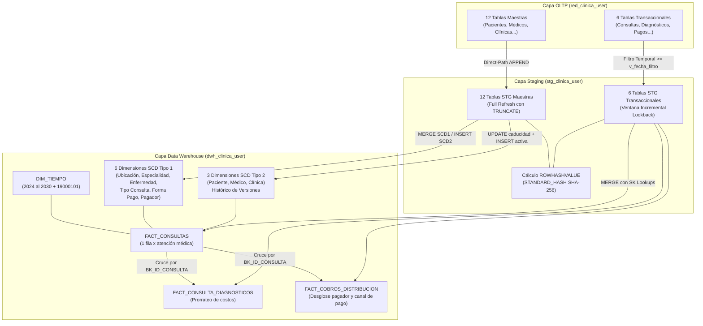
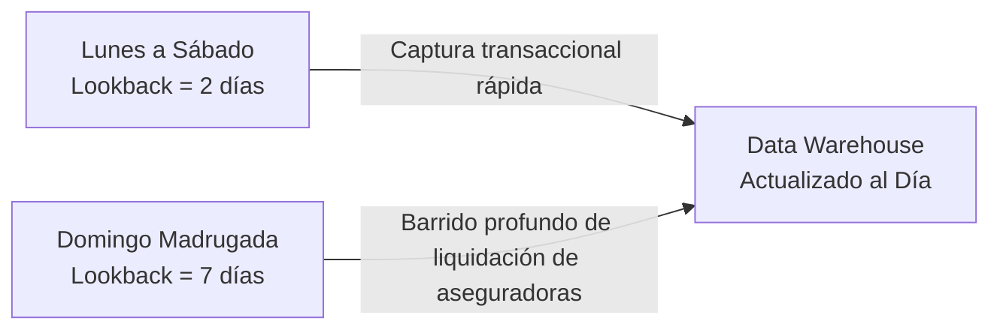
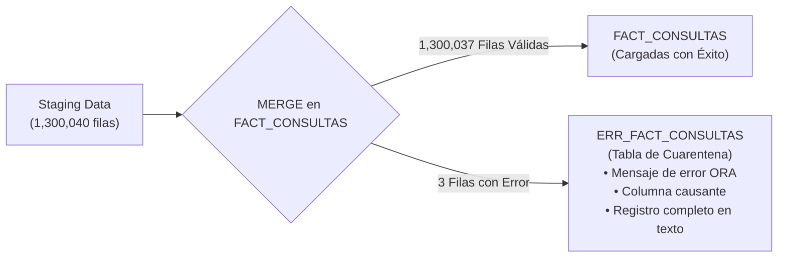
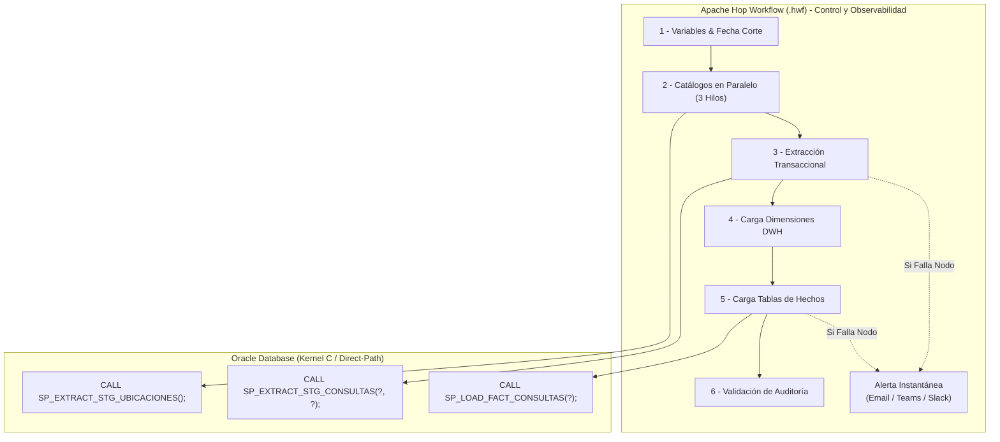

# Manual Operativo y Arquitectura del Pipeline Data Warehouse

**Proyecto:** Data Warehouse para Red Asistencial de Clínicas
**Motor:** Oracle Database 19c / 21c / 23ai (`XEPDB1`)
**Metodología:** Star Schema | **Patrón ETL:** In-Database Direct-Path con Hash SHA-256

---

## 1. Visión General del Pipeline End-to-End

El sistema analítico extrae datos transaccionales desde el sistema hospitalario OLTP (`red_clinica_user`, 8.34M filas), los procesa a través de una zona intermedia de Staging (`stg_clinica_user`) calculando huellas digitales criptográficas al vuelo, y los consolida en un modelo en estrella (`dwh_clinica_user`) compuesto por 10 dimensiones y 3 tablas de hechos.



---

## 2. Modalidades de Ejecución: Full Refresh vs Incremental Lookback

El procedimiento maestro orquestador [`SP_LOAD_DWH_MASTER`](file:///d:/Diego/Cursos/KODIGO%20SQL%20IA/ProyectoFinal/DWH/StoredProcedures/SP_LOAD_DWH_MASTER.sql) soporta dos modos operativos configurables por parámetros:

```sql
PROCEDURE SP_LOAD_DWH_MASTER (
    p_tipo_carga    IN VARCHAR2 DEFAULT 'INCREMENTAL', -- 'FULL' o 'INCREMENTAL'
    p_dias_lookback IN NUMBER   DEFAULT 3,             -- Días de ventana hacia atrás
    p_fecha_corte   IN DATE     DEFAULT NULL           -- Fecha base opcional (por defecto SYSDATE)
);
```

### A. Modo Inicialización / Recalibración Completa (`FULL`)

* **Invocación:**
  ```sql
  EXEC SP_LOAD_DWH_MASTER('FULL');
  ```
* **Mecánica:**
  1. Fija internamente la fecha de corte en `DATE '1900-01-01'`.
  2. Vacía (`TRUNCATE`) cada tabla de Staging y extrae el 100% de las 18 tablas de OLTP (8,336,492 registros).
  3. Carga el calendario `DIM_TIEMPO` completo (2024 al 2030).
  4. Realiza el merge completo en dimensiones SCD1, inicializa versiones base en SCD2 (`CURRENTFLAG = 1`) y puebla las 3 tablas de hechos completas.
* **Tiempo de Ejecución:** ~5 a 7 minutos para el volumen total de 8.34M de registros.

---

### B. Modo Producción Diaria / Carga Incremental (`INCREMENTAL`)

* **Invocación Regular:**
  ```sql
  EXEC SP_LOAD_DWH_MASTER('INCREMENTAL', 2);
  ```
* **Mecánica Temporal:**
  $$
  \text{v\_fecha\_filtro} = \text{TRUNC(SYSDATE)} - \text{p\_dias\_lookback}
  $$
* **Ventana de Reproceso Histórico (Simulación de Incidentes):**
  Si ocurrió una falla hace 15 días o se desea re-extraer un período histórico específico con fecha fija:
  ```sql
  EXEC SP_LOAD_DWH_MASTER('INCREMENTAL', 15, DATE '2026-08-20');
  ```

---

## 3. Estrategia Operativa de Calendario: Delta Diario + Barrido Semanal

Para optimizar recursos y capturar transacciones rezagadas sin intervención manual, se implementa el patrón **Daily Delta + Weekly Sweep**:


| Frecuencia  | Días                 | Ventana Lookback | Justificación de Negocio                                                                                                                                | Tiempo Ejecución |
| :---------- | :-------------------- | :--------------: | :------------------------------------------------------------------------------------------------------------------------------------------------------- | :---------------: |
| **Diario**  | Lun a Sáb (02:00 AM) |   **2 Días**   | Captura atenciones del día anterior y transacciones de medianoche (23:59 a 00:05). Mínimo consumo de CPU.                                              |  **~5 - 10 seg**  |
| **Semanal** | Domingo (02:00 AM)    | **7 u 8 Días** | Las aseguradoras y convenios corporativos liquidan copagos con 3 a 5 días de desfase. El barrido dominical atrapa ajustes contables y abonos diferidos. | **~30 - 45 seg** |



---

## 4. Análisis Capa por Capa y Mecanismos de Control Anti-Duplicados

### Capa 1: STAGING (`stg_clinica_user`)

1. **Idempotencia Garantizada:** Todo procedimiento de extracción inicia con `EXECUTE IMMEDIATE 'TRUNCATE TABLE STG_...'`. La capa intermedia nunca acumula filas de corridas pasadas.
2. **Cálculo de Hash SHA-256 al Vuelo:** Durante el `INSERT /*+ APPEND */`, se ejecuta `STANDARD_HASH(..., 'SHA256')` concatenando atributos descriptivos con delimitador `|` y protección de nulos con `NVL`.
3. **Cascada Financiera Inversa en Carga Incremental:**
   En Staging, `STG_TRANSACCIONES_PAGO` se extrae **antes** que `STG_COBROS_CONSULTA`. Si un paciente abonó hoy un pago a una factura de hace 60 días, la consulta de cobros la rescata mediante:

   ```sql
   WHERE o.FECHA_EMISION >= v_fecha_filtro
      OR o.ID_COBRO IN (SELECT ID_COBRO FROM STG_TRANSACCIONES_PAGO);
   ```

   Esto asegura que ninguna factura antigua quede desfasada tras un pago reciente.

---

### Capa 2: DIMENSIONES EN DWH (`dwh_clinica_user`)

#### A. Dimensiones SCD Tipo 1 (Sobreescritura con Hash)

*Tablas:* `DIM_UBICACION`, `DIM_ESPECIALIDAD`, `DIM_ENFERMEDAD`, `DIM_TIPO_CONSULTA`, `DIM_FORMA_PAGO`, `DIM_PAGADOR`.

* Control de Unicidad: `ON (d.BK_ID = s.ID)` respaldado por restricciones `UNIQUE`.
* Optimización de E/S: `WHERE d.ROWHASHVALUE != s.ROWHASHVALUE`. Si el registro en OLTP no cambió en los últimos N días, Oracle no realiza ninguna actualización física en bloque.
* Riesgo de Duplicados: **0%**.

#### B. Dimensiones SCD Tipo 2 (Histórico de Cambios)

*Tablas:* `DIM_PACIENTE`, `DIM_MEDICO`, `DIM_CLINICA`.

* Paso 1 (Caducidad): Busca registros activos (`CURRENTFLAG = 1`) cuyo hash sea distinto al que viene de Staging y les marca `CURRENTFLAG = 0` y `FECHAFIN = SYSDATE - 1 segundo`.
* Paso 2 (Nueva Versión): Inserta la nueva versión activa (`CURRENTFLAG = 1`, `FECHAFIN = 2999-12-31`) mediante `WHERE NOT EXISTS (BK_ID = s.ID AND CURRENTFLAG = 1 AND ROWHASHVALUE = s.ROWHASHVALUE)`.
* Riesgo de Duplicados: **0%**. Si el paciente no cambió durante la ventana lookback, ni se caduca ni se inserta.

---

### Capa 3: TABLAS DE HECHOS (`dwh_clinica_user`)

*Tablas:* `FACT_CONSULTAS`, `FACT_CONSULTA_DIAGNOSTICOS`, `FACT_COBROS_DISTRIBUCION`.

1. **Resolución de Surrogate Keys (SK Lookups):**
   Las llaves foráneas hacia dimensiones se resuelven en memoria mediante `INNER JOIN` / `LEFT JOIN` hacia las dimensiones activas (`CURRENTFLAG = 1` o vigencia por fecha).
2. **Claves de Negocio Únicas:**
   - `FACT_CONSULTAS` posee `CONSTRAINT UQ_FACT_CONS_BK UNIQUE (BK_ID_CONSULTA)`.
   - `FACT_CONSULTA_DIAGNOSTICOS` posee `CONSTRAINT UQ_FACT_CDIAG_BK UNIQUE (BK_ID_DIAGNOSTICO)`.
   - `FACT_COBROS_DISTRIBUCION` posee `CONSTRAINT UQ_FACT_CDIST_BK UNIQUE (BK_ID_DISTRIBUCION)`.
3. **Mecánica del `MERGE` en Hechos:**
   - Si la atención médica ocurre por primera vez $\rightarrow$ `WHEN NOT MATCHED THEN INSERT (...)`.
   - Si la atención médica ya existía en el DWH y entró en la ventana lookback porque recibió un nuevo abono en OLTP $\rightarrow$ `WHEN MATCHED THEN UPDATE SET f.MONTO_TOTAL_PAGADO = s.MONTO_TOTAL_PAGADO, f.SALDO_PENDIENTE = s.SALDO_PENDIENTE WHERE f.ROWHASHVALUE != s.HASH_HECHO`.
   - Riesgo de Duplicados: **0%**.

---

## 5. Cuadre Contable y Conciliación Demostrada

En la ejecución completa de las 8.34 millones de filas, los balances financieros arrojaron cuadre exacto al centavo:

```
[Métricas Financieras Globales Conciliadas]
  • Facturación Bruta (FACT_CONSULTAS):          $86,688,740.28
  • Monto Asignado (FACT_COBROS_DISTRIBUCION):   $86,688,740.28   (Diferencia: $0.00)
  ───────────────────────────────────────────────────────────────────────────
  • Recaudación Total (FACT_CONSULTAS):          $65,851,445.95
  • Recaudación Pagadores (FACT_COBROS_DISTRIB): $65,851,445.95   (Diferencia: $0.00)
  ───────────────────────────────────────────────────────────────────────────
  • Saldo Pendiente Moroso (FACT_CONSULTAS):     $20,837,294.33
  • Saldo Pendiente (FACT_COBROS_DISTRIBUCION):  $20,837,294.33   (Diferencia: $0.00)
```

---

## 6. Comandos Operativos de Referencia

```sql
-- Conectado como dwh_clinica_user:

-- 1. Ejecución diaria regular (2 días)
EXEC SP_LOAD_DWH_MASTER('INCREMENTAL', 2);

-- 2. Barrido semanal dominical (7 días)
EXEC SP_LOAD_DWH_MASTER('INCREMENTAL', 7);

-- 3. Carga de contingencia / reproceso por incidente (15 días desde fecha fija)
EXEC SP_LOAD_DWH_MASTER('INCREMENTAL', 15, DATE '2026-08-20');

-- 4. Inicialización completa desde cero
EXEC SP_LOAD_DWH_MASTER('FULL');
```

---

## 7. Manejo de Errores en Producción, Aislamiento por Fila y Resiliencia

### A. Limitaciones de un Procedimiento Monolítico en Producción

En sistemas empresariales de misión crítica, depender exclusivamente de un único script monolítico (`SP_LOAD_DWH_MASTER`) presenta desventajas operativas:

1. **Efecto Caja Negra (*Black Box*):** Durante los 5 o 10 minutos de ejecución, no hay visibilidad porcentual de avance por tabla.
2. **Falla en Cascada (Todo o Nada):** Si se procesan 14 tablas exitosamente y en la tabla 15 falla 1 solo registro, el bloque `EXCEPTION WHEN OTHERS THEN ROLLBACK;` aborta todo el lote.
3. **Pérdida de Identificación de Fila:** Un `MERGE` masivo estándar en Oracle no reporta qué fila específica causó un desbordamiento numérico o de texto; únicamente arroja un error genérico (ej. `ORA-01438` o `ORA-12899`).

---

### B. Solución Empresarial: Tablas de Cuarentena con `DBMS_ERRLOG`

Oracle permite habilitar **DML Error Logging** para que el pipeline no se detenga si aparecen datos corruptos aislados, desviando únicamente las filas anómalas a una tabla de auditoría:



#### Implementación Técnica:

1. **Creación de la tabla de errores:**
   ```sql
   EXEC DBMS_ERRLOG.CREATE_ERROR_LOG('FACT_CONSULTAS', 'ERR_FACT_CONSULTAS');
   ```
2. **Integración en la sentencia `MERGE`:**
   ```sql
   MERGE INTO FACT_CONSULTAS f
   USING (...) s ON (...)
   WHEN MATCHED THEN ...
   WHEN NOT MATCHED THEN INSERT (...)
   LOG ERRORS INTO ERR_FACT_CONSULTAS ('BATCH_' || TO_CHAR(SYSDATE, 'YYYYMMDD'))
   REJECT LIMIT UNLIMITED;
   ```

* **Ventaja:** El 99.99% de los datos ingresa al Data Warehouse y queda disponible de inmediato para Power BI y reportes ejecutivos. El equipo de ingeniería de datos solo consulta `SELECT * FROM ERR_FACT_CONSULTAS` a la mañana siguiente para corregir los registros atípicos en OLTP.

---

### C. Arquitectura Híbrida Recomendada: Apache Hop como Orquestador + SPs como Motor de Ejecución

La arquitectura recomendada en producción combina la potencia de procesamiento en base de datos con la observabilidad visual de un orquestador ETL:



#### Beneficios Clave:

* **Sin Sobrecarga de Red ni Memoria:** Los millones de registros se procesan dentro del motor Oracle mediante `APPEND` directo sin viajar por la red hacia la memoria RAM de Apache Hop.
* **Trazabilidad Visual:** Cada paso se ilumina en verde o rojo en tiempo real con su tiempo exacto de duración.
* **Reanudación desde el Punto de Fallo (*Checkpoint Restart*):** Si falla un hecho específico, el operador puede corregir el dato y reanudar el flujo exactamente desde ese nodo, sin re-ejecutar las tablas anteriores.

> [!TIP]
> **Implementación Física en el Repositorio:**
> Los 4 archivos de workflow (`wf_dwh_master.hwf`, `wf_01_staging.hwf`, `wf_02_dimensiones.hwf`, `wf_03_hechos.hwf`) y la metadata de conexión a base de datos se encuentran completamente implementados y documentados en el directorio [`HOP/`](file:///d:/Diego/Cursos/KODIGO%20SQL%20IA/ProyectoFinal/HOP/) (ver manual operativo detallado en [`HOP/README.md`](file:///d:/Diego/Cursos/KODIGO%20SQL%20IA/ProyectoFinal/HOP/README.md)).

---

## 8. Auditoría y Monitoreo de Procesos: Tabla de Control `CTL_ETL_AUDIT`

En un Data Warehouse empresarial conviven dos niveles de auditoría indispensables:

1. **Auditoría a Nivel de Datos (Micro):** Las 6 columnas técnicas en cada tabla (`CURRENTFLAG`, `TIPOCARGA`, `FECHAINICIO`, `FECHAFIN`, `TIPOTRANSACCION`, `ROWHASHVALUE`), que auditan el ciclo de vida de cada registro.
2. **Auditoría a Nivel de Proceso (Macro):** Una tabla centralizada de control de ejecuciones (`CTL_ETL_AUDIT`), que registra el rendimiento, estado, duración y volumen procesado en cada ejecución.

### DDL de la Tabla de Control `CTL_ETL_AUDIT`

```sql
CREATE TABLE CTL_ETL_AUDIT (
    ID_AUDIT              NUMBER GENERATED ALWAYS AS IDENTITY (START WITH 1 INCREMENT BY 1),
    BATCH_ID              VARCHAR2(50)  NOT NULL,              -- Identificador único del lote (ej. BATCH_20261022_0200)
    CAPA                  VARCHAR2(20)  NOT NULL,              -- 'STAGING', 'DWH_DIM', 'DWH_FACT'
    OBJETO_DESTINO        VARCHAR2(60)  NOT NULL,              -- Nombre de la tabla (ej. FACT_CONSULTAS)
    PROCEDIMIENTO         VARCHAR2(60)  NOT NULL,              -- Nombre del SP (ej. SP_LOAD_FACT_CONSULTAS)
    TIPO_CARGA            VARCHAR2(20)  DEFAULT 'INCREMENTAL', -- 'FULL' o 'INCREMENTAL'
    FECHA_INICIO          TIMESTAMP     DEFAULT SYSTIMESTAMP NOT NULL,
    FECHA_FIN             TIMESTAMP,
    DURACION_SEGUNDOS     NUMBER(10,2),
    FILAS_LEIDAS          NUMBER(12)    DEFAULT 0,
    FILAS_INSERTADAS      NUMBER(12)    DEFAULT 0,
    FILAS_ACTUALIZADAS    NUMBER(12)    DEFAULT 0,
    FILAS_RECHAZADAS      NUMBER(12)    DEFAULT 0,
    ESTADO                VARCHAR2(20)  DEFAULT 'RUNNING',     -- 'RUNNING', 'SUCCESS', 'WARNING', 'FAILED'
    CODIGO_ERROR          VARCHAR2(30),
    MENSAJE_ERROR         VARCHAR2(4000),
    USUARIO_EJECUCION     VARCHAR2(60)  DEFAULT USER,
    HOST_NAME             VARCHAR2(100) DEFAULT SYS_CONTEXT('USERENV', 'HOST'),
    CONSTRAINT PK_CTL_ETL_AUDIT PRIMARY KEY (ID_AUDIT),
    CONSTRAINT CK_CTL_AUD_ESTADO CHECK (ESTADO IN ('RUNNING', 'SUCCESS', 'WARNING', 'FAILED'))
);

CREATE INDEX IX_CTL_AUD_BATCH  ON CTL_ETL_AUDIT (BATCH_ID);
CREATE INDEX IX_CTL_AUD_FECHA  ON CTL_ETL_AUDIT (FECHA_INICIO);
CREATE INDEX IX_CTL_AUD_ESTADO ON CTL_ETL_AUDIT (ESTADO);

-- Otorgar privilegios de lectura y escritura a stg_clinica_user
GRANT SELECT, INSERT, UPDATE ON CTL_ETL_AUDIT TO stg_clinica_user;
```

### Arquitectura de Registro Autónomo (`PRAGMA AUTONOMOUS_TRANSACTION`)

Para evitar que un fallo de negocio con `ROLLBACK` borre el registro de auditoría, se implementaron 3 procedimientos utilitarios con transacciones autónomas en el esquema `dwh_clinica_user`:

```sql
-- 1. Registro de Inicio
CREATE OR REPLACE PROCEDURE SP_AUDIT_START (
    p_batch_id       IN  VARCHAR2,
    p_capa           IN  VARCHAR2,
    p_objeto_destino IN  VARCHAR2,
    p_procedimiento  IN  VARCHAR2,
    p_tipo_carga     IN  VARCHAR2,
    o_id_audit       OUT NUMBER
)
AUTHID DEFINER IS
    PRAGMA AUTONOMOUS_TRANSACTION;
BEGIN
    INSERT INTO CTL_ETL_AUDIT (
        BATCH_ID, CAPA, OBJETO_DESTINO, PROCEDIMIENTO, TIPO_CARGA, FECHA_INICIO, ESTADO
    ) VALUES (
        p_batch_id, UPPER(p_capa), UPPER(p_objeto_destino), UPPER(p_procedimiento),
        UPPER(p_tipo_carga), SYSTIMESTAMP, 'RUNNING'
    ) RETURNING ID_AUDIT INTO o_id_audit;
    COMMIT;
END SP_AUDIT_START;
/

-- 2. Registro de Éxito y Cálculo de Duración
CREATE OR REPLACE PROCEDURE SP_AUDIT_END (
    p_id_audit           IN NUMBER,
    p_filas_leidas       IN NUMBER DEFAULT 0,
    p_filas_insertadas   IN NUMBER DEFAULT 0,
    p_filas_actualizadas IN NUMBER DEFAULT 0,
    p_filas_rechazadas   IN NUMBER DEFAULT 0,
    p_estado             IN VARCHAR2 DEFAULT 'SUCCESS'
)
AUTHID DEFINER IS
    PRAGMA AUTONOMOUS_TRANSACTION;
    v_inicio TIMESTAMP;
BEGIN
    SELECT FECHA_INICIO INTO v_inicio FROM CTL_ETL_AUDIT WHERE ID_AUDIT = p_id_audit;
    UPDATE CTL_ETL_AUDIT
    SET FECHA_FIN          = SYSTIMESTAMP,
        DURACION_SEGUNDOS  = ROUND(
            EXTRACT(DAY FROM (SYSTIMESTAMP - v_inicio)) * 86400 +
            EXTRACT(HOUR FROM (SYSTIMESTAMP - v_inicio)) * 3600 +
            EXTRACT(MINUTE FROM (SYSTIMESTAMP - v_inicio)) * 60 +
            EXTRACT(SECOND FROM (SYSTIMESTAMP - v_inicio)), 2
        ),
        FILAS_LEIDAS       = NVL(p_filas_leidas, 0),
        FILAS_INSERTADAS   = NVL(p_filas_insertadas, 0),
        FILAS_ACTUALIZADAS = NVL(p_filas_actualizadas, 0),
        FILAS_RECHAZADAS   = NVL(p_filas_rechazadas, 0),
        ESTADO             = NVL(p_estado, 'SUCCESS')
    WHERE ID_AUDIT = p_id_audit;
    COMMIT;
EXCEPTION WHEN OTHERS THEN ROLLBACK;
END SP_AUDIT_END;
/

-- 3. Registro de Fallo (Preservado ante ROLLBACK)
CREATE OR REPLACE PROCEDURE SP_AUDIT_ERROR (
    p_id_audit      IN NUMBER,
    p_codigo_error  IN VARCHAR2,
    p_mensaje_error IN VARCHAR2
)
AUTHID DEFINER IS
    PRAGMA AUTONOMOUS_TRANSACTION;
    v_inicio TIMESTAMP;
BEGIN
    BEGIN
        SELECT FECHA_INICIO INTO v_inicio FROM CTL_ETL_AUDIT WHERE ID_AUDIT = p_id_audit;
    EXCEPTION WHEN OTHERS THEN v_inicio := SYSTIMESTAMP;
    END;
    UPDATE CTL_ETL_AUDIT
    SET FECHA_FIN         = SYSTIMESTAMP,
        DURACION_SEGUNDOS = ROUND(
            EXTRACT(DAY FROM (SYSTIMESTAMP - v_inicio)) * 86400 +
            EXTRACT(HOUR FROM (SYSTIMESTAMP - v_inicio)) * 3600 +
            EXTRACT(MINUTE FROM (SYSTIMESTAMP - v_inicio)) * 60 +
            EXTRACT(SECOND FROM (SYSTIMESTAMP - v_inicio)), 2
        ),
        ESTADO            = 'FAILED',
        CODIGO_ERROR      = SUBSTR(p_codigo_error, 1, 30),
        MENSAJE_ERROR     = SUBSTR(p_mensaje_error, 1, 4000)
    WHERE ID_AUDIT = p_id_audit;
    COMMIT;
EXCEPTION WHEN OTHERS THEN ROLLBACK;
END SP_AUDIT_ERROR;
/

-- Privilegios otorgados a Staging:
GRANT EXECUTE ON SP_AUDIT_START TO stg_clinica_user;
GRANT EXECUTE ON SP_AUDIT_END   TO stg_clinica_user;
GRANT EXECUTE ON SP_AUDIT_ERROR TO stg_clinica_user;
```

### Propagación del Identificador de Lote (`BATCH_ID`)

Todos los 34 stored procedures de STAGING y DWH aceptan un parámetro opcional:

```sql
p_batch_id IN VARCHAR2 DEFAULT NULL
```

- **Ejecución Vía Orquestador Maestro (`SP_LOAD_DWH_MASTER`):**
  Genera un único identificador temporal al inicio (ej. `BATCH_20261022_143825`) y lo transmite hacia `SP_EXTRACT_OLTP_TO_STG`, las 18 extracciones de Staging, las 10 dimensiones y las 3 tablas de hechos. Esto permite que **todos los pasos queden agrupados bajo el mismo lote**.
- **Ejecución Individual o Vía Apache Hop:**
  Si el orquestador externo o un usuario ejecuta un SP de forma aislada sin proveer `p_batch_id`, el procedimiento genera automáticamente su propio identificador:
  ```sql
  v_batch_id := NVL(p_batch_id, 'BATCH_' || TO_CHAR(SYSDATE, 'YYYYMMDD_HH24MISS'));
  ```

### Evidencia de Ejecución Real en Base de Datos

Resultado de la corrida de validación de `SP_LOAD_DWH_MASTER('INCREMENTAL', 1)` auditada en vivo:


| ID    | BATCH_ID                | CAPA             | OBJETO_DESTINO                 | TIPO          | DURACIÓN  | INSERTADAS | ACTUALIZADAS | ESTADO      |
| ----- | ----------------------- | ---------------- | ------------------------------ | ------------- | ---------- | ---------- | ------------ | ----------- |
| **3** | `BATCH_20261022_143825` | **ORCHESTRATOR** | `DWH_ALL`                      | `INCREMENTAL` | **9.84 s** | 0          | 0            | **SUCCESS** |
| **4** | `BATCH_20261022_143825` | **STAGING**      | `STAGING_ALL`                  | `INCREMENTAL` | **6.62 s** | 0          | 0            | **SUCCESS** |
| 5     | `BATCH_20261022_143825` | STAGING          | `STG_UBICACIONES`              | `INCREMENTAL` | 0.05 s     | 262        | 0            | **SUCCESS** |
| 6     | `BATCH_20261022_143825` | STAGING          | `STG_CLINICAS`                 | `INCREMENTAL` | 0.03 s     | 270        | 0            | **SUCCESS** |
| 7     | `BATCH_20261022_143825` | STAGING          | `STG_EMPRESAS`                 | `INCREMENTAL` | 0.03 s     | 68         | 0            | **SUCCESS** |
| 8     | `BATCH_20261022_143825` | STAGING          | `STG_ASEGURADORAS`             | `INCREMENTAL` | 0.03 s     | 10         | 0            | **SUCCESS** |
| 9     | `BATCH_20261022_143825` | STAGING          | `STG_PACIENTES`                | `INCREMENTAL` | 1.59 s     | 100,032    | 0            | **SUCCESS** |
| 10    | `BATCH_20261022_143825` | STAGING          | `STG_ESPECIALIDADES`           | `INCREMENTAL` | 0.03 s     | 30         | 0            | **SUCCESS** |
| 11    | `BATCH_20261022_143825` | STAGING          | `STG_MEDICOS`                  | `INCREMENTAL` | 0.05 s     | 916        | 0            | **SUCCESS** |
| 12    | `BATCH_20261022_143825` | STAGING          | `STG_MEDICOS_ESPECIALIDADES`   | `INCREMENTAL` | 0.05 s     | 1,370      | 0            | **SUCCESS** |
| 13    | `BATCH_20261022_143825` | STAGING          | `STG_ENFERMEDADES`             | `INCREMENTAL` | 0.03 s     | 66         | 0            | **SUCCESS** |
| 14    | `BATCH_20261022_143825` | STAGING          | `STG_TIPOS_CONSULTA`           | `INCREMENTAL` | 0.03 s     | 9          | 0            | **SUCCESS** |
| 15    | `BATCH_20261022_143825` | STAGING          | `STG_PROCEDIMIENTOS`           | `INCREMENTAL` | 0.05 s     | 36         | 0            | **SUCCESS** |
| 16    | `BATCH_20261022_143825` | STAGING          | `STG_FORMAS_PAGO`              | `INCREMENTAL` | 0.04 s     | 9          | 0            | **SUCCESS** |
| 17    | `BATCH_20261022_143825` | STAGING          | `STG_CONSULTAS`                | `INCREMENTAL` | 0.03 s     | 0          | 0            | **SUCCESS** |
| 18    | `BATCH_20261022_143825` | STAGING          | `STG_DIAGNOSTICOS`             | `INCREMENTAL` | 0.17 s     | 0          | 0            | **SUCCESS** |
| 19    | `BATCH_20261022_143825` | STAGING          | `STG_CONSULTAS_PROCEDIMIENTOS` | `INCREMENTAL` | 0.36 s     | 0          | 0            | **SUCCESS** |
| 20    | `BATCH_20261022_143825` | STAGING          | `STG_TRANSACCIONES_PAGO`       | `INCREMENTAL` | 0.04 s     | 0          | 0            | **SUCCESS** |
| 21    | `BATCH_20261022_143825` | STAGING          | `STG_COBROS_CONSULTA`          | `INCREMENTAL` | 3.99 s     | 0          | 0            | **SUCCESS** |
| 22    | `BATCH_20261022_143825` | STAGING          | `STG_DISTRIBUCION_COBRO`       | `INCREMENTAL` | 0.02 s     | 0          | 0            | **SUCCESS** |
| 23    | `BATCH_20261022_143825` | DWH_DIM          | `DIM_TIEMPO`                   | `FULL`        | 0.05 s     | 2,557      | 0            | **SUCCESS** |
| 24    | `BATCH_20261022_143825` | DWH_DIM          | `DIM_UBICACION`                | `INCREMENTAL` | 0.01 s     | 0          | 0            | **SUCCESS** |
| 25    | `BATCH_20261022_143825` | DWH_DIM          | `DIM_ESPECIALIDAD`             | `INCREMENTAL` | 0.00 s     | 0          | 0            | **SUCCESS** |
| 26    | `BATCH_20261022_143825` | DWH_DIM          | `DIM_ENFERMEDAD`               | `INCREMENTAL` | 0.00 s     | 0          | 0            | **SUCCESS** |
| 27    | `BATCH_20261022_143825` | DWH_DIM          | `DIM_TIPO_CONSULTA`            | `INCREMENTAL` | 0.00 s     | 0          | 0            | **SUCCESS** |
| 28    | `BATCH_20261022_143825` | DWH_DIM          | `DIM_FORMA_PAGO`               | `INCREMENTAL` | 0.00 s     | 0          | 0            | **SUCCESS** |
| 29    | `BATCH_20261022_143825` | DWH_DIM          | `DIM_PAGADOR`                  | `INCREMENTAL` | 1.55 s     | 0          | 0            | **SUCCESS** |
| 30    | `BATCH_20261022_143825` | DWH_DIM          | `DIM_CLINICA`                  | `INCREMENTAL` | 0.01 s     | 0          | 0            | **SUCCESS** |
| 31    | `BATCH_20261022_143825` | DWH_DIM          | `DIM_MEDICO`                   | `INCREMENTAL` | 0.02 s     | 0          | 0            | **SUCCESS** |
| 32    | `BATCH_20261022_143825` | DWH_DIM          | `DIM_PACIENTE`                 | `INCREMENTAL` | 1.50 s     | 0          | 0            | **SUCCESS** |
| 33    | `BATCH_20261022_143825` | DWH_FACT         | `FACT_CONSULTAS`               | `INCREMENTAL` | 0.04 s     | 0          | 0            | **SUCCESS** |
| 34    | `BATCH_20261022_143825` | DWH_FACT         | `FACT_CONSULTA_DIAGNOSTICOS`   | `INCREMENTAL` | 0.01 s     | 0          | 0            | **SUCCESS** |
| 35    | `BATCH_20261022_143825` | DWH_FACT         | `FACT_COBROS_DISTRIBUCION`     | `INCREMENTAL` | 0.03 s     | 0          | 0            | **SUCCESS** |

### Consultas de Monitoreo sobre la Tabla de Control

```sql
-- 1. Ver el estado y duración del último lote ejecutado
SELECT 
    PROCEDIMIENTO, 
    OBJETO_DESTINO, 
    ESTADO, 
    DURACION_SEGUNDOS, 
    FILAS_INSERTADAS, 
    FILAS_ACTUALIZADAS, 
    FILAS_RECHAZADAS
FROM CTL_ETL_AUDIT
WHERE BATCH_ID = (SELECT MAX(BATCH_ID) FROM CTL_ETL_AUDIT)
ORDER BY ID_AUDIT ASC;

-- 2. Detección de fallos en los últimos 7 días
SELECT 
    FECHA_INICIO, 
    PROCEDIMIENTO, 
    OBJETO_DESTINO, 
    CODIGO_ERROR, 
    MENSAJE_ERROR
FROM CTL_ETL_AUDIT
WHERE ESTADO = 'FAILED'
  AND FECHA_INICIO >= SYSDATE - 7
ORDER BY FECHA_INICIO DESC;

-- 3. Análisis de tendencias de SLA y duración promedio
SELECT 
    PROCEDIMIENTO,
    COUNT(*) AS TOTAL_CORRIDAS,
    ROUND(AVG(DURACION_SEGUNDOS), 2) AS DURACION_PROMEDIO_SEG,
    MAX(DURACION_SEGUNDOS)           AS DURACION_MAXIMA_SEG,
    SUM(FILAS_INSERTADAS)            AS TOTAL_INSERTADAS
FROM CTL_ETL_AUDIT
WHERE ESTADO = 'SUCCESS'
GROUP BY PROCEDIMIENTO
ORDER BY DURACION_PROMEDIO_SEG DESC;
```

---

## 9. Manual de Operaciones y Protocolo de Troubleshooting para el Data Engineer

Este protocolo estandariza el diagnóstico, contención y resolución de anomalías para el equipo de Ingeniería de Datos y DBA a cargo de la operación del pipeline en producción.

### 9.1 Automatización con el Script Wrapper `ejecutar_pipeline_diario.bat`

Para garantizar la ejecución desatendida recurrente en servidores Windows sin fallos por variables de entorno de usuario, el proyecto cuenta con el script ejecutable:
[`HOP/ejecutar_pipeline_diario.bat`](file:///d:/Diego/Cursos/KODIGO%20SQL%20IA/ProyectoFinal/HOP/ejecutar_pipeline_diario.bat).

#### Beneficios Clave del Script:

1. **Aislamiento de Rutas:** Configura explícitamente `PROJECT_DIR` y la ruta de instalación de Apache Hop (`HOP_DIR`), evitando depender del `PATH` del usuario que ejecuta la sesión.
2. **Logs Fechados con Precisión de Segundo:** Redirige la salida de la consola a archivos rotativos diarios en `HOP/logs/hop_run_YYYYMMDD_HHMMSS.log`.
3. **Control de Códigos de Salida (`%ERRORLEVEL%`):** Retorna `0` en caso de éxito y `> 0` en caso de error para que herramientas de calendarización (Windows Task Scheduler, Airflow, Jenkins) detecten el estado real.
4. **Soporte de Argumentos Dinámicos:** Admite parámetros por línea de comandos para reprocesamientos manuales:
   ```cmd
   :: Carga diaria habitual (3 días lookback):
   ejecutar_pipeline_diario.bat

   :: Carga histórica masiva (Full Load):
   ejecutar_pipeline_diario.bat FULL 0

   :: Recuperación de días caídos (Lookback extendido a 15 días):
   ejecutar_pipeline_diario.bat INCREMENTAL 15
   ```

---

### 9.2 Checklist Matutino: Consulta de Semáforo Diario

El Data Engineer de guardia puede verificar el estado de salud de la corrida nocturna ejecutando en `dwh_clinica_user`:

```sql
SELECT 
    BATCH_ID,
    TO_CHAR(MIN(FECHA_INICIO), 'YYYY-MM-DD HH24:MI:SS') AS INICIO_LOTE,
    COUNT(*)                                            AS TOTAL_PASOS,
    SUM(CASE WHEN ESTADO = 'SUCCESS' THEN 1 ELSE 0 END) AS PASOS_EXITOSOS,
    SUM(CASE WHEN ESTADO = 'FAILED'  THEN 1 ELSE 0 END) AS PASOS_FALLIDOS,
    ROUND(SUM(DURACION_SEGUNDOS), 2)                    AS SEGUNDOS_TOTALES,
    CASE 
        WHEN SUM(CASE WHEN ESTADO = 'FAILED' THEN 1 ELSE 0 END) = 0 THEN 'VERDE - PIPELINE EXITOSO'
        ELSE 'ROJO - INCIDENTE DETECTADO'
    END AS SEMAFORO
FROM CTL_ETL_AUDIT
WHERE FECHA_INICIO >= TRUNC(SYSDATE)
GROUP BY BATCH_ID
ORDER BY INICIO_LOTE DESC;
```

---

### 9.3 Matriz de Troubleshooting (Top Errores Comunes de Producción)

A continuación se presenta la matriz de incidentes frecuentes y su resolución inmediata:


| Código / Error                                                 | Causa Raíz Probable                                                                | Impacto en Pipeline                                                         | Acción Inmediata del Data Engineer                                                               |
| --------------------------------------------------------------- | ----------------------------------------------------------------------------------- | --------------------------------------------------------------------------- | ------------------------------------------------------------------------------------------------- |
| **`ORA-01653` / `ORA-01658`**<br>*unable to extend table/index* | Datafiles llenos en`stg_clinicas_db` o `dwh_clinicas_db` sin autoextend activo.     | El procedimiento aborta inmediatamente y revierte la transacción.          | Conectarse como`SYS AS SYSDBA` y habilitar `AUTOEXTEND` en el datafile afectado.                  |
| **`ORA-12541` / `ORA-12170`**<br>*TNS:no listener / timeout*    | Listener de Oracle detenido o contenedor pluggable`XEPDB1` no montado.              | Hop no puede conectar al iniciar el workflow maestro.                       | Iniciar servicio con`lsnrctl start` y abrir la PDB con `ALTER PLUGGABLE DATABASE XEPDB1 OPEN;`.   |
| **`ORA-01555`**<br>*snapshot too old*                           | Transacciones masivas concurrentes en OLTP que sobreescriben bloques de Undo.       | Falla la extracción de tablas grandes (`CONSULTAS`, `TRANSACCIONES_PAGO`). | Aumentar el parámetro de retención con`ALTER SYSTEM SET UNDO_RETENTION = 7200;`.                |
| **`ORA-00001`**<br>*unique constraint violated*                 | Clave primaria duplicada en la fuente OLTP no filtrada.                             | Rechazo de la inserción en Staging o Hechos.                               | Consultar`CTL_ETL_AUDIT.MENSAJE_ERROR`, identificar la BK duplicada y depurar en origen.          |
| **`ORA-01400`**<br>*cannot insert NULL into (...)*              | Un campo obligatorio en destino viene nulo desde la fuente relacional.              | Inserción rechazada.                                                       | Verificar la columna informada en el error y ajustar la regla`NVL(...)` en el SP correspondiente. |
| **`OutOfMemoryError`**<br>*Java heap space en Apache Hop*       | Memoria RAM por defecto de la JVM de Hop insuficiente para el volumen de metadatos. | Hop-run se congela o finaliza abruptamente.                                 | Ampliar memoria en el servidor con`set HOP_JAVA_OPTIONS="-Xms1024m -Xmx4096m"`.                   |

---

#### Guía Detallada de Remediación Técnica

1. **Tablespace Lleno (`ORA-01653` / `ORA-01658`):**
   Conectarse en SQL*Plus o SQL Developer como `SYS AS SYSDBA` en el contenedor `XEPDB1`:

   ```sql
   ALTER DATABASE DATAFILE 'dwh_clinicas_db.dbf' AUTOEXTEND ON NEXT 500M MAXSIZE UNLIMITED;
   ALTER DATABASE DATAFILE 'stg_clinicas_db.dbf' AUTOEXTEND ON NEXT 500M MAXSIZE UNLIMITED;
   ```
2. **Servicio o Listener Detenido (`ORA-12541` / `ORA-12170`):**
   Abrir una terminal de PowerShell o CMD como Administrador:

   ```powershell
   # Iniciar el Listener de Oracle
   lsnrctl status
   lsnrctl start

   # Asegurar que la Pluggable Database esté abierta
   sqlplus sys/Password2026@localhost:1521/XEPDB1 as sysdba
   ALTER PLUGGABLE DATABASE XEPDB1 OPEN;
   ```
3. **Sobrescritura de Bloques de Undo (`ORA-01555`):**
   Extender el periodo de retención de Undo a 2 horas (7,200 segundos):

   ```sql
   ALTER SYSTEM SET UNDO_RETENTION = 7200 SCOPE=BOTH;
   ```
4. **Memoria Insuficiente en Apache Hop (`Java heap space`):**
   Definir la variable de entorno de Java antes de invocar `hop-run.bat`:

   ```cmd
   set HOP_JAVA_OPTIONS="-Xms1024m -Xmx4096m"
   ```

---

### 9.4 Procedimiento de Backfill (Recuperación de Días Perdidos)

Si el servidor estuvo apagado durante varios días (ejemplo: corte de energía o mantenimiento de fin de semana):

1. **No se debe ejecutar el pipeline repetidamente por cada día transcurrido.**
2. Basta con ejecutar el script incrementando la ventana de lookback para cubrir todos los días transcurridos:

```cmd
D:\Diego\Cursos\KODIGO SQL IA\ProyectoFinal\HOP\ejecutar_pipeline_diario.bat INCREMENTAL 7
```

> [!NOTE]
> Esto procesará los 4 días caídos más los 3 días de lookback habitual. Gracias a los `MERGE` basados en `HASH_HECHO` (SHA-256) en las tablas de hechos, la carga es 100% idempotente y no generará duplicados ni descuadres contables.

---

### 9.5 Políticas de Mantenimiento y Retención

1. **Purga de Archivos de Log Locales (`HOP/logs/`):**
   Los logs en texto plano acumulan ~150 KB por ejecución. Se recomienda programar una limpieza periódica mediante PowerShell para logs mayores a 90 días:
   ```powershell
   Get-ChildItem -Path "D:\Diego\Cursos\KODIGO SQL IA\ProyectoFinal\HOP\logs" -Filter *.log | `
       Where-Object { $_.LastWriteTime -lt (Get-Date).AddDays(-90) } | `
       Remove-Item -Force
   ```
2. **Mantenimiento de la Tabla `CTL_ETL_AUDIT`:**
   La tabla registra ~34 filas diarias (~1,000 registros al mes). Para depurar registros históricos exitosos con antigüedad superior a 1 año:
   ```sql
   DELETE FROM dwh_clinica_user.CTL_ETL_AUDIT
   WHERE FECHA_INICIO < ADD_MONTHS(SYSDATE, -12)
     AND ESTADO = 'SUCCESS';
   COMMIT;
   ```
