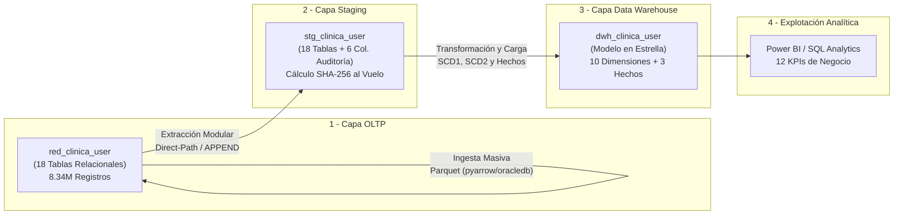

# Proyecto Final: Data Warehouse para Red Asistencial de Clínicas

**Módulo:** SQL & Inteligencia Artificial aplicada a Datos | **Grupo:** 3

## 1. Equipo de Trabajo (Grupo 3)


|      # | Integrante                                    | Rol / Aporte Principal                           |
| -----: | --------------------------------------------- | ------------------------------------------------ |
|  **1** | **Oscar Alexander López Gómez** — *Líder* | Coordinación general, Arquitectura DW / ETL, BI |
|  **2** | **Gerson Wilfredo Mendoza Murillo**           | Referente técnico SQL / DBA, modelado, Power BI |
|  **3** | **Dionisio Alberto Méndez Nerio**            | Power BI avanzado, análisis                     |
|  **4** | **Diego Alejandro Rosa Iraheta**              | SQL, desarrollo                                  |
|  **5** | **Cristian Alfredo Martínez García**        | SQL, resolución de problemas                    |
|  **6** | **Bryan Alexander Berrio Martínez**          | ETL, desarrollo                                  |
|  **7** | **Daniel Alberto Santamaría Cartagena**      | Desarrollo, SQL, Power BI                        |
|  **8** | **Carmen Elena López Ramos**                 | Sistemas, BD                                     |
|  **9** | **Gerson Jonathan Berrio Martínez**          | Full Stack / desarrollo                          |
| **10** | **Jennifer Alejandra Nieto Portillo**         | BD / Power BI básico, aprendizaje               |
| **11** | **Diego Alexander Alas Morales**              | Data Analytics, SQL, ETL, Data Warehouse         |
| **12** | **William Emmanuel Mazariego Orellana**       | Modelado dimensional, ETL, SQL, Power BI         |
| **13** | **David Ernesto Lindo Argueta**               | SQL, Python, desarrollo y modelado               |

## 2. Arquitectura de la Solución

El proyecto implementa un pipeline analítico end-to-end de grado empresarial sobre **Oracle Database (Pluggable Database `XEPDB1`)**, procesando más de **8.33 millones de registros** sin pérdida de información:



## 3. Estructura Limpia del Repositorio

```plaintext
/ProyectoFinal/
├── MANUAL_DATAWAREHOUSE_PIPELINE.md     <- Manual integral: arquitectura, flujo end-to-end, errores y auditoría
├── audit_pipeline.py                    <- Auditoría técnica y conciliación financiera centavo a centavo
├── reglas_dwh_oracle.md                 <- Estándares de arquitectura Kimball, SCD1/SCD2 y Hash SHA-256
├── README.md                            <- Guía maestra de despliegue y documentación general
│
├── PASOS_CREACION/                      <- Despliegue Secuencial Paso a Paso (00 al 06 en scripts .sql)
│   ├── 00_INFRAESTRUCTURA_Y_USUARIOS.sql            <- SYS: Crea tablespaces y usuarios
│   ├── 01_CREAR_TABLAS_OLTP.sql                     <- red_clinica_user: 18 tablas OLTP (+ Ingesta Parquet)
│   ├── 02_CREAR_TABLAS_STAGING.sql                  <- stg_clinica_user: 18 tablas Staging
│   ├── 03_CREAR_TABLAS_Y_PROCEDIMIENTOS_DWH.sql     <- dwh_clinica_user: Tablas DWH + SPs Auditoría y Carga
│   ├── 04_CREAR_PROCEDIMIENTOS_STAGING.sql          <- stg_clinica_user: 19 SPs de extracción
│   ├── 05_EJECUTAR_ETL_DWH.sql                      <- dwh_clinica_user: Ejecución SP_LOAD_DWH_MASTER('FULL')
│   ├── 06_VALIDAR_KPIS_Y_AUDITORIA.sql              <- dwh_clinica_user: Validación de conteos y 12 KPIs
│   └── README.md                                    <- Guía rápida con tabla de conexiones y credenciales
│
├── OLTP/                                <- Capa Transaccional (red_clinica_user)
│   ├── 01_CREAR_TODAS_LAS_TABLAS_OLTP.sql   <- DDL maestro consolidado (18 tablas + índices + triggers)
│   ├── README.md                            <- Guía detallada de la capa OLTP
│   ├── Tables/                              <- 18 DDLs individuales por tabla
│   ├── Indexes/                             <- Índices B-Tree complementarios en Foreign Keys
│   ├── Triggers/                            <- Triggers de reglas de negocio y validación clínica
│   └── Data/
│       ├── *.parquet                        <- 18 archivos de datos productivos (8,336,492 filas)
│       └── IngestaParquet/
│           ├── requirements.txt             <- Dependencias Python (oracledb, pyarrow, pandas)
│           ├── ingestar_parquets_oltp.py    <- Runner de ingesta masiva por lotes (array binds)
│           ├── 00_LIMPIAR_TABLAS_OLTP.sql   <- Truncate ordenado para reinicio
│           ├── 01_PRE_INGESTA_IDENTITY_BY_DEFAULT.sql   <- Habilita carga de IDs existentes
│           ├── 02_POST_INGESTA_IDENTITY_ALWAYS_RESTART.sql <- Reactiva secuencias Identity
│           └── 03_AUDITORIA_INTEGRIDAD_INGESTA.sql      <- Verificación de conteos y llaves
│
├── STAGING/                             <- Capa Intermedia de Ingesta (stg_clinica_user)
│   ├── 01_CREAR_TODAS_LAS_TABLAS_STAGING.sql        <- DDL maestro consolidado (18 tablas Staging)
│   ├── 02_CREAR_TODOS_LOS_STORED_PROCEDURES_STAGING.sql <- PL/SQL maestro de los 19 procedimientos con auditoría
│   ├── README.md                                    <- Guía detallada de la capa Staging
│   ├── Tables/                                      <- 18 DDLs individuales de tablas Staging
│   └── StoredProcedures/                            <- 19 SPs individuales con auditoría nativa
│
├── DWH/                                 <- Capa Data Warehouse (dwh_clinica_user)
│   ├── CTL_ETL_AUDIT.sql                            <- DDL y procedimientos autónomos de control y auditoría
│   ├── 01_CREAR_TODAS_LAS_TABLAS_DWH.sql            <- DDL maestro consolidado (13 modelo + 1 tabla control)
│   ├── 02_CREAR_TODOS_LOS_STORED_PROCEDURES_DWH.sql <- PL/SQL maestro consolidado (3 auditoría + 15 analíticos)
│   ├── 03_VALIDACION_KPIS_NEGOCIO.sql               <- 12 consultas analíticas oficiales de negocio
│   ├── README.md                                    <- Guía detallada de la capa DWH
│   ├── DimTables/                                   <- 10 DDLs individuales de dimensiones
│   ├── FactTables/                                  <- 3 DDLs individuales de tablas de hechos
│   └── StoredProcedures/                            <- 18 SPs individuales (3 auditoría + 15 analíticos)
│
└── HOP/                                 <- Orquestación Gráfica y Automatizada (Apache Hop)
    ├── wf_dwh_master.hwf                            <- Workflow maestro que orquesta los 3 sub-workflows
    ├── wf_01_staging.hwf                            <- Workflow modular de extracción hacia Staging
    ├── wf_02_dimensiones.hwf                        <- Workflow modular de carga de Dimensiones
    ├── wf_03_hechos.hwf                             <- Workflow modular de carga de Hechos
    ├── metadata/relational-database-connection/     <- Conexión JDBC nativa a Oracle Database
    └── README.md                                    <- Guía completa de Apache Hop (GUI, CLI y Programación)
```

## 4. Guía de Despliegue Rápido Paso a Paso

> [!TIP]
> **¿Ruta directa y guiada script por script?**
> Hemos creado la carpeta [`PASOS_CREACION/`](./PASOS_CREACION/), que reúne en 7 scripts `.sql` numerados del `00` al `06` toda la secuencia de creación, compilación y ejecución. Cada archivo incluye en sus primeras líneas el usuario de conexión, contraseña y si requiere alguna acción externa por consola. Puedes consultar el resumen en [`PASOS_CREACION/README.md`](./PASOS_CREACION/README.md).

Sigue esta secuencia para levantar el proyecto desde cero en cualquier máquina con Oracle Database y Python:

### Prerrequisitos

1. **Oracle Database 19c, 21c o 23ai** con la Pluggable Database `XEPDB1` iniciada en `localhost:1521` o la que poseas en tu maquina.
2. **Python 3.10 o superior**.
3. Cliente SQL preferido (SQL Developer, DBeaver, VS Code, etc).

---

### Paso 0: Crear Tablespaces, Usuarios y Privilegios

Conectado como **`SYS AS SYSDBA`** o **`SYSTEM`** en el contenedor `XEPDB1`:

- Ejecuta el script: [`PASOS_CREACION/00_INFRAESTRUCTURA_Y_USUARIOS.sql`](./PASOS_CREACION/00_INFRAESTRUCTURA_Y_USUARIOS.sql)

> **Credenciales creadas:**
>
> - OLTP: `red_clinica_user` / `Password2026`
> - STAGING: `stg_clinica_user` / `StagingPass2026`
> - DWH: `dwh_clinica_user` / `DwhPass2026`

---

### Paso 1: Capa OLTP (Estructura e Ingesta de Datos)

1. **Crear las 18 tablas relacionales:**Conéctate como `red_clinica_user` y ejecuta:

   - [`OLTP/01_CREAR_TODAS_LAS_TABLAS_OLTP.sql`](file:///d:/Diego/Cursos/KODIGO%20SQL%20IA/ProyectoFinal/OLTP/01_CREAR_TODAS_LAS_TABLAS_OLTP.sql)
     *(O de forma modular desde [OLTP/Tables/](file:///d:/Diego/Cursos/KODIGO%20SQL%20IA/ProyectoFinal/OLTP/Tables/), [OLTP/Indexes/](file:///d:/Diego/Cursos/KODIGO%20SQL%20IA/ProyectoFinal/OLTP/Indexes/) y [OLTP/Triggers/](file:///d:/Diego/Cursos/KODIGO%20SQL%20IA/ProyectoFinal/OLTP/Triggers/))*.
2. **Ingestar los 8.34M de registros Parquet:**
   Abre una terminal en la raíz del proyecto:

   ```powershell
   # 1. Instalar librerías de Python
   pip install -r "OLTP/Data/IngestaParquet/requirements.txt"

   # 2. Ejecutar la ingesta de alta velocidad (duración: 3 a 5 minutos)
   python "OLTP/Data/IngestaParquet/ingestar_parquets_oltp.py"
   ```

---

### Paso 2: Tablas de la Capa STAGING

Conéctate como stg_clinica_user:

1. **Crear las 18 tablas de Staging:**
   - Ejecuta: [STAGING/01_CREAR_TODAS_LAS_TABLAS_STAGING.sql](file:///d:/Diego/Cursos/KODIGO%20SQL%20IA/ProyectoFinal/STAGING/01_CREAR_TODAS_LAS_TABLAS_STAGING.sql)

---

### Paso 3: Capa DATA WAREHOUSE (Tablas y Procedimientos)

Conéctate como dwh_clinica_user:

1. **Crear las 14 tablas del DWH (10 dimensiones + 3 hechos + tabla de control CTL_ETL_AUDIT):**
   - Ejecuta: [DWH/01_CREAR_TODAS_LAS_TABLAS_DWH.sql](file:///d:/Diego/Cursos/KODIGO%20SQL%20IA/ProyectoFinal/DWH/01_CREAR_TODAS_LAS_TABLAS_DWH.sql)
2. **Compilar los 18 stored procedures del DWH (Auditoría autónoma + Carga analítica):**
   - Ejecuta: [DWH/02_CREAR_TODOS_LOS_STORED_PROCEDURES_DWH.sql](file:///d:/Diego/Cursos/KODIGO%20SQL%20IA/ProyectoFinal/DWH/02_CREAR_TODOS_LOS_STORED_PROCEDURES_DWH.sql)

> [!IMPORTANT]
> Este paso crea los procedimientos de auditoría (SP_AUDIT_START, SP_AUDIT_END, SP_AUDIT_ERROR) y otorga automáticamente los privilegios GRANT EXECUTE a stg_clinica_user. Debe ejecutarse **antes** de compilar los procedimientos de Staging para evitar el error de dependencias PLS-00201.

---

### Paso 4: Procedimientos de Extracción de STAGING

Conéctate como stg_clinica_user:

1. **Compilar los 19 stored procedures de extracción:**
   - Ejecuta: [STAGING/02_CREAR_TODOS_LOS_STORED_PROCEDURES_STAGING.sql](file:///d:/Diego/Cursos/KODIGO%20SQL%20IA/ProyectoFinal/STAGING/02_CREAR_TODOS_LOS_STORED_PROCEDURES_STAGING.sql)

> [!NOTE]
> Ahora compila al 100% sin errores porque los procedimientos de auditoría del DWH ya existen con sus respectivos permisos concedidos. Asimismo, la columna ID_CLINICA_BASE en MEDICOS se extrae sin conflictos hacia STG_MEDICOS.ID_CLINICA.

---


### Paso 5: Ejecutar la Orquestación ETL Completa

Conéctate como `dwh_clinica_user` en tu cliente SQL y ejecuta el procedimiento orquestador end-to-end:

```sql
-- Carga completa inicial (Full Load de 8.34M filas)
EXEC SP_LOAD_DWH_MASTER('FULL');

-- Para cargas recurrentes en producción (Ventana incremental de 3 días)
EXEC SP_LOAD_DWH_MASTER('INCREMENTAL', 3);
```

*Este comando orquesta automáticamente la extracción OLTP $\rightarrow$ Staging con direct-path insert, la carga de Dimensiones SCD1 y SCD2, y la carga de las 3 tablas de hechos con resolución de Surrogate Keys*.

---

### Paso 6: Auditoría Técnica, Monitoreo y Validación de KPIs

1. **Monitoreo de Auditoría de Procesos (Tabla de Control `CTL_ETL_AUDIT`):**
   Conéctate como `dwh_clinica_user` y revisa la ejecución del último lote procesado:

   ```sql
   SELECT 
       ID_AUDIT, BATCH_ID, CAPA, OBJETO_DESTINO, PROCEDIMIENTO, 
       DURACION_SEGUNDOS, FILAS_INSERTADAS, FILAS_ACTUALIZADAS, ESTADO
   FROM CTL_ETL_AUDIT
   WHERE BATCH_ID = (SELECT MAX(BATCH_ID) FROM CTL_ETL_AUDIT)
   ORDER BY ID_AUDIT ASC;
   ```
2. **Auditoría de Integridad y Balance Contable:**
   Ejecuta en consola:

   ```powershell
   python audit_pipeline.py
   ```

   *Verifica automáticamente el 100% de coincidencia de filas entre OLTP y Staging, cero claves foráneas nulas en las tablas de hechos y cuadre contable exacto al centavo ($86,688,740.28)*.
3. **Validación de Consultas de Negocio:**
   Conéctate como `dwh_clinica_user` y ejecuta el script:

   - [`DWH/03_VALIDACION_KPIS_NEGOCIO.sql`](file:///d:/Diego/Cursos/KODIGO%20SQL%20IA/ProyectoFinal/DWH/03_VALIDACION_KPIS_NEGOCIO.sql)
     *Responde las 12 preguntas institucionales (pacientes por clínica, morosidad por pagador, ranking de patologías CIE-10, productividad médica, etc.)*.

---

### Paso 7: Orquestación Visual con Apache Hop (Opcional)

Si utilizas **Apache Hop** como orquestador empresarial para calendarizar o monitorear visualmente los procesos:

1. Abre **Apache Hop GUI** (`hop-gui.bat` o `hop-gui.sh`).
2. Abre el workflow maestro: [`HOP/wf_dwh_master.hwf`](file:///d:/Diego/Cursos/KODIGO%20SQL%20IA/ProyectoFinal/HOP/wf_dwh_master.hwf).
3. Presiona **Run**  y selecciona los parámetros (`TIPO_CARGA = 'INCREMENTAL'`, `DIAS_LOOKBACK = 3`).
4. Para automatizar mediante CLI o programador de tareas (Cron / Windows Task Scheduler), revisa la guía completa en [`HOP/README.md`](file:///d:/Diego/Cursos/KODIGO%20SQL%20IA/ProyectoFinal/HOP/README.md).
